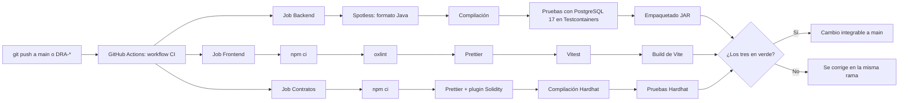

# Integración continua

- **Tarea Jira:** DRA-43
- **Configuración:** [`.github/workflows/ci.yml`](../../.github/workflows/ci.yml)
- **Resultados:** pestaña **Actions** del repositorio (https://github.com/Garyn14/TESIS_FERNANDO/actions)

## 1. Propósito

La integración continua (CI) comprueba de forma automática que cada cambio subido al repositorio compila, respeta el formato acordado y pasa sus pruebas. Así `main` siempre queda en un estado funcional y cada incremento del sprint se integra sin errores con los anteriores, que es uno de los criterios de culminación de la sección 3.2.4.5 de la tesis.

## 2. Cuándo se ejecuta

| Evento | Ramas |
|---|---|
| `push` | `main` y cualquier rama que empiece con `DRA-` (por ejemplo `DRA-14-login-por-rol`) |
| `pull_request` | Cualquier pull request hacia el repositorio |

Una ejecución completa tarda entre 1 y 2 minutos. El job más lento es el del backend, porque levanta un PostgreSQL real para las pruebas.

## 3. Flujo

Los tres jobs corren **en paralelo** y son independientes: si falla uno, los otros terminan igual y se ve qué parte del proyecto tiene el problema.

## 4. Qué valida cada job

### Backend (Java + Spring Boot)

| Paso | Comando | Qué asegura |
|---|---|---|
| Preparación | `actions/setup-java@v5` (Temurin 21) con caché de Maven | Misma versión de Java que en desarrollo (ADR-001) |
| Formato, compilación y pruebas | `./mvnw -B verify` | **Spotless** falla si el código no sigue el formato de Google Java Format. Compila con Java 21 y ejecuta las pruebas de JUnit. Las pruebas levantan un **PostgreSQL 17 real con Testcontainers**, así se validan las migraciones de Flyway contra el mismo motor que se usa en producción. |

### Frontend (React + Vite)

| Paso | Comando | Qué asegura |
|---|---|---|
| Instalación | `npm ci` | Instala exactamente las versiones de `package-lock.json` |
| Linter | `npm run lint` (oxlint) | Errores comunes de React y TypeScript |
| Formato | `npm run format:check` (Prettier) | Formato uniforme |
| Pruebas | `npm test` (Vitest + Testing Library) | Comportamiento de los componentes |
| Build | `npm run build` | Revisión de tipos de TypeScript y build de producción de Vite |

### Contratos (Hardhat)

| Paso | Comando | Qué asegura |
|---|---|---|
| Instalación | `npm ci` | Versiones exactas de Hardhat y OpenZeppelin |
| Formato | `npm run format:check` | Formato uniforme, incluido Solidity (`prettier-plugin-solidity`) |
| Compilación | `npm run compile` | El contrato compila con Solidity 0.8.30 |
| Pruebas | `npm test` | Pruebas del contrato en la red simulada de Hardhat |

## 5. Cómo leer un resultado

1. En GitHub, abre la pestaña **Actions** o el ícono ✓/✗ que aparece junto a cada commit.
2. Cada ejecución muestra los tres jobs. Uno en rojo indica qué parte falló.
3. Al entrar al job se ve el paso exacto que falló y su registro.
4. Con **GitHub for Jira** instalado, el estado del build también aparece dentro de cada historia en Jira.

## 6. Qué hacer si falla

Se reproduce en local con el mismo comando del paso que falló y se corrige en la misma rama:

| Falla en | Reproducir | Corrección habitual |
|---|---|---|
| Formato del backend | `./mvnw spotless:check` | `./mvnw spotless:apply` |
| Pruebas del backend | `./mvnw verify` (requiere Docker) | Revisar `target/surefire-reports/` |
| Linter o formato del frontend | `npm run lint` / `npm run format:check` | `npm run format` |
| Pruebas del frontend | `npm test` | — |
| Contratos | `npm run compile` / `npm test` | `npm run format` para el formato |

Un cambio no se integra a `main` mientras alguno de los jobs esté en rojo.

## 7. Decisiones

| Decisión | Motivo |
|---|---|
| Un solo workflow con tres jobs en paralelo | Es más simple de mantener y da una vista única del estado del proyecto |
| Testcontainers con PostgreSQL 17 en lugar de una base en memoria (H2) | Las migraciones de Flyway y las consultas se prueban contra el mismo motor de producción |
| Maven Wrapper (`mvnw`) | Fija la versión de Maven (3.9.16) sin que haya que instalarla en el runner ni en local |
| `npm ci` con `package-lock.json` | Builds reproducibles con las mismas versiones en CI y en local |
| Compilar el contrato en CI | El compilador de Solidity se descarga en el runner de GitHub. En entornos con la red restringida esa descarga puede estar bloqueada, y la CI queda como la verificación de referencia |
| Actions en `@v5` (`checkout`, `setup-java`, `setup-node`) | Las versiones `@v4` usan Node.js 20, que GitHub marcó como obsoleto |

## 8. Evidencia (para el Capítulo III)

| Fecha | Ejecución | Rama | Resultado |
|---|---|---|---|
| 29/10/2026 | [40792393119](https://github.com/Garyn14/TESIS_FERNANDO/actions/runs/40792393119) | `DRA-43-estructura-ci` | ✓ Los tres jobs en verde (con avisos de actions obsoletas) |
| 29/10/2026 | [40792574492](https://github.com/Garyn14/TESIS_FERNANDO/actions/runs/40792574492) | `DRA-43-estructura-ci` | ✓ Los tres jobs en verde, sin avisos, tras actualizar a `@v5` |

## 9. Pendientes

- ~~Instalar **GitHub for Jira**~~: instalado el 29/10/2026 (DRA-43).
- Cuando existan los servicios de Besu (DRA-45) e IPFS (DRA-46), agregar pruebas de integración que los levanten.
- Agregar análisis de dependencias vulnerables (Dependabot) en un sprint posterior.
