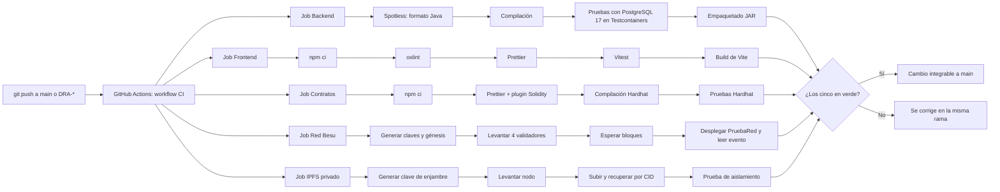

# Integración continua

- **Tarea Jira:** DRA-43
- **Configuración:** [`.github/workflows/ci.yml`](../../.github/workflows/ci.yml)
- **Resultados:** pestaña **Actions** del repositorio (https://github.com/Garyn14/TESIS_FERNANDO/actions)

## 1. Propósito

La integración continua (CI) comprueba de forma automática que cada cambio subido al repositorio compila, respeta el formato acordado y pasa sus pruebas. Así `main` siempre queda en un estado funcional y cada incremento del sprint se integra sin errores con los anteriores, que es uno de los criterios de culminación de la sección 3.2.4.5 de la tesis.

## 2. Cuándo se ejecuta

| Evento | Ramas |
|---|---|
| `push` | `main` y cualquier rama que empiece con `DRA-` (por ejemplo `DRA-14-login-por-rol`) |
| `pull_request` | Cualquier pull request hacia el repositorio |

Una ejecución completa tarda unos 2 minutos. Los jobs más lentos son el de la red Besu, que levanta 4 nodos, y el del backend, que levanta un PostgreSQL real para las pruebas.

## 3. Flujo

Los cinco jobs corren **en paralelo** y son independientes: si falla uno, los otros terminan igual y se ve qué parte del proyecto tiene el problema.

## 4. Qué valida cada job

### Backend (Java + Spring Boot)

| Paso | Comando | Qué asegura |
|---|---|---|
| Preparación | `actions/setup-java@v5` (Temurin 21) con caché de Maven | Misma versión de Java que en desarrollo (ADR-001) |
| Formato, compilación y pruebas | `./mvnw -B verify` | **Spotless** falla si el código no sigue el formato de Google Java Format. Compila con Java 21 y ejecuta las pruebas de JUnit. Las pruebas levantan un **PostgreSQL 17 real con Testcontainers**, así se validan las migraciones de Flyway contra el mismo motor que se usa en producción. |

### Frontend (React + Vite)

| Paso | Comando | Qué asegura |
|---|---|---|
| Instalación | `npm ci` | Instala exactamente las versiones de `package-lock.json` |
| Linter | `npm run lint` (oxlint) | Errores comunes de React y TypeScript |
| Formato | `npm run format:check` (Prettier) | Formato uniforme |
| Pruebas | `npm test` (Vitest + Testing Library) | Comportamiento de los componentes |
| Build | `npm run build` | Revisión de tipos de TypeScript y build de producción de Vite |

### Contratos (Hardhat)

| Paso | Comando | Qué asegura |
|---|---|---|
| Instalación | `npm ci` | Versiones exactas de Hardhat y OpenZeppelin |
| Formato | `npm run format:check` | Formato uniforme, incluido Solidity (`prettier-plugin-solidity`) |
| Compilación | `npm run compile` | El contrato compila con Solidity 0.8.30 |
| Pruebas | `npm test` | Pruebas del contrato en la red simulada de Hardhat |

### Red Besu (QBFT, 4 validadores)

Agregado en DRA-45.

| Paso | Comando | Qué asegura |
|---|---|---|
| Generar la red | `plataforma/infra/besu/generar-red.sh` | Claves de 4 validadores, génesis QBFT y lista de nodos permitidos, nuevas en cada ejecución |
| Levantar nodos | `docker compose --profile besu up -d besu-nodo1 … besu-nodo4` | La configuración de `docker-compose.yml` arranca |
| Esperar bloques | Consulta `eth_blockNumber` hasta el bloque 3 (máximo 2 minutos) | El consenso QBFT funciona entre los 4 nodos |
| Prueba de humo | `npm run probar:besu` (`scripts/probar-red-besu.ts`) | `chainId` 20260; 4 validadores; una cuenta nueva **sin saldo** despliega `PruebaRed.sol` y envía una transacción con `gasPrice` 0; el evento se lee y el saldo sigue en 0 (RNF11) |
| Contrato de la plataforma | `npm run probar:registro` (`scripts/probar-registro-besu.ts`) | Agregado en DRA-17: `RegistroDocumentos` se despliega con dos administradores; el Administrador otorga el rol de firmante y el respaldo lo revoca, en la red real y sin saldo |
| Si falla | `docker compose logs` | Deja en el registro los últimos mensajes de los nodos |

### IPFS privado

Agregado en DRA-46.

| Paso | Comando | Qué asegura |
|---|---|---|
| Generar la clave | `plataforma/infra/ipfs/generar-clave.sh` | Clave de enjambre nueva en cada ejecución |
| Levantar el nodo | `docker compose --profile ipfs up -d --wait ipfs` | El nodo arranca en modo privado (`LIBP2P_FORCE_PNET=1`) |
| Prueba de humo | `./ipfs/probar-ipfs.sh` | 0 nodos de arranque y 0 pares; un archivo subido con CIDv1 se recupera idéntico y queda fijado |
| Aislamiento | `./ipfs/probar-aislamiento.sh` | Un nodo sin la clave es rechazado y uno con la misma clave se conecta (RNF03) |
| Si falla | `docker compose logs` | Deja en el registro los últimos mensajes del nodo |

## 5. Cómo leer un resultado

1. En GitHub, abre la pestaña **Actions** o el ícono ✓/✗ que aparece junto a cada commit.
2. Cada ejecución muestra los cinco jobs. Uno en rojo indica qué parte falló.
3. Al entrar al job se ve el paso exacto que falló y su registro.
4. Con **GitHub for Jira** instalado, el estado del build también aparece dentro de cada historia en Jira.

## 6. Qué hacer si falla

Se reproduce en local con el mismo comando del paso que falló y se corrige en la misma rama:

| Falla en | Reproducir | Corrección habitual |
|---|---|---|
| Formato del backend | `./mvnw spotless:check` | `./mvnw spotless:apply` |
| Pruebas del backend | `./mvnw verify` (requiere Docker) | Revisar `target/surefire-reports/` |
| Linter o formato del frontend | `npm run lint` / `npm run format:check` | `npm run format` |
| Pruebas del frontend | `npm test` | — |
| Contratos | `npm run compile` / `npm test` | `npm run format` para el formato |
| Red Besu | `./besu/generar-red.sh` + `docker compose --profile besu up -d` + `npm run probar:besu` | Revisar `docker compose --profile besu logs` |
| IPFS privado | `./ipfs/generar-clave.sh` + `docker compose --profile ipfs up -d` + `./ipfs/probar-ipfs.sh` | Revisar `docker compose --profile ipfs logs` |

Un cambio no se integra a `main` mientras alguno de los jobs esté en rojo.

## 7. Decisiones

| Decisión | Motivo |
|---|---|
| Un solo workflow con tres jobs en paralelo | Es más simple de mantener y da una vista única del estado del proyecto |
| Testcontainers con PostgreSQL 17 en lugar de una base en memoria (H2) | Las migraciones de Flyway y las consultas se prueban contra el mismo motor de producción |
| Maven Wrapper (`mvnw`) | Fija la versión de Maven (3.9.16) sin que haya que instalarla en el runner ni en local |
| `npm ci` con `package-lock.json` | Builds reproducibles con las mismas versiones en CI y en local |
| Compilar el contrato en CI | El compilador de Solidity se descarga en el runner de GitHub. En entornos con la red restringida esa descarga puede estar bloqueada, y la CI queda como la verificación de referencia |
| Actions en `@v5` (`checkout`, `setup-java`, `setup-node`) | Las versiones `@v4` usan Node.js 20, que GitHub marcó como obsoleto |

## 8. Evidencia (para el Capítulo III)

| Fecha | Ejecución | Rama | Resultado |
|---|---|---|---|
| 29/10/2026 | [40792393119](https://github.com/Garyn14/TESIS_FERNANDO/actions/runs/40792393119) | `DRA-43-estructura-ci` | ✓ Los tres jobs en verde (con avisos de actions obsoletas) |
| 29/10/2026 | [40792574492](https://github.com/Garyn14/TESIS_FERNANDO/actions/runs/40792574492) | `DRA-43-estructura-ci` | ✓ Los tres jobs en verde, sin avisos, tras actualizar a `@v5` |
| 29/10/2026 | [40797880888](https://github.com/Garyn14/TESIS_FERNANDO/actions/runs/40797880888) | `DRA-45-red-besu` | ✓ Cuatro jobs en verde, incluido el nuevo job Red Besu |
| 29/10/2026 | [40814310340](https://github.com/Garyn14/TESIS_FERNANDO/actions/runs/40814310340) | `DRA-46-ipfs-privado` | ✓ Cinco jobs en verde, incluido el nuevo job IPFS privado |
| 29/10/2026 | [40898899824](https://github.com/Garyn14/TESIS_FERNANDO/actions/runs/40898899824) | `DRA-12-crear-cuentas` | ✓ Cinco jobs en verde con la primera historia (HU01) |
| 29/10/2026 | [40903595082](https://github.com/Garyn14/TESIS_FERNANDO/actions/runs/40903595082) | `DRA-13-editar-desactivar-cuentas` | ✓ Cinco jobs en verde con HU02 |
| 29/10/2026 | [40913715547](https://github.com/Garyn14/TESIS_FERNANDO/actions/runs/40913715547) | `DRA-14-inicio-de-sesion` | ✓ Cinco jobs en verde con HU03 (53 pruebas de backend, 31 de frontend) |
| 29/10/2026 | [40928314920](https://github.com/Garyn14/TESIS_FERNANDO/actions/runs/40928314920) | `DRA-15-cambiar-restablecer-contrasena` | ✓ Cinco jobs en verde con HU04 (63 pruebas de backend, 44 de frontend) |
| 29/10/2026 | [40940857854](https://github.com/Garyn14/TESIS_FERNANDO/actions/runs/40940857854) | `DRA-16-area-de-usuario` | ✓ Cinco jobs en verde con HU05 (74 pruebas de backend, 49 de frontend) |
| 29/10/2026 | [40944693594](https://github.com/Garyn14/TESIS_FERNANDO/actions/runs/40944693594) | `DRA-17-billetera-y-firmante` | ✓ Cinco jobs en verde con HU06: contrato compilado con el compilador oficial, 15 pruebas de Hardhat y RegistroDocumentos probado en la red Besu real (92 pruebas de backend, 59 de frontend) |
| 01/11/2026 | [41333365036](https://github.com/Garyn14/TESIS_FERNANDO/actions/runs/41333365036) | `DRA-18-tipo-de-documento` | ✓ Cinco jobs en verde con HU07, la primera del Sprint 2 (99 pruebas de backend, 66 de frontend) |
| 01/11/2026 | [41335816519](https://github.com/Garyn14/TESIS_FERNANDO/actions/runs/41335816519) | `DRA-19-solicitud-de-parte` | ✓ Cinco jobs en verde con HU08: migración V10 de documentos validada contra PostgreSQL 17 real (111 pruebas de backend, 76 de frontend) |
| 01/11/2026 | [41347416010](https://github.com/Garyn14/TESIS_FERNANDO/actions/runs/41347416010) | `DRA-20-emision-por-lista` | ✓ Cinco jobs en verde con HU09: migración V11 de lotes y lectura de Excel con Apache POI (123 pruebas de backend, 85 de frontend) |
| 03/11/2026 | [41677224185](https://github.com/Garyn14/TESIS_FERNANDO/actions/runs/41677224185) | `DRA-19-fechas-dia-mes-anio` | ✓ Cinco jobs en verde con la corrección de la revisión del Sprint 2: fechas en día/mes/año (123 pruebas de backend, 90 de frontend) |
| 03/11/2026 | [41743421533](https://github.com/Garyn14/TESIS_FERNANDO/actions/runs/41743421533) | `DRA-21-por-revisar` | ✓ Cinco jobs en verde con HU10, la primera del Sprint 3: migración V12 y revisión atómica (129 pruebas de backend, 95 de frontend) |
| 03/11/2026 | [41745602040](https://github.com/Garyn14/TESIS_FERNANDO/actions/runs/41745602040) | `DRA-24-pdf-final` | ✓ Cinco jobs en verde con HU16: PDF final con OpenPDF, QR con ZXing y SHA-256 (135 pruebas de backend, 95 de frontend) |

## 9. Pendientes

- ~~Instalar **GitHub for Jira**~~: instalado el 29/10/2026 (DRA-43).
- Cuando el backend integre Besu e IPFS (Sprint 3), agregar pruebas de integración del backend contra esos servicios.
- Agregar análisis de dependencias vulnerables (Dependabot) en un sprint posterior.
