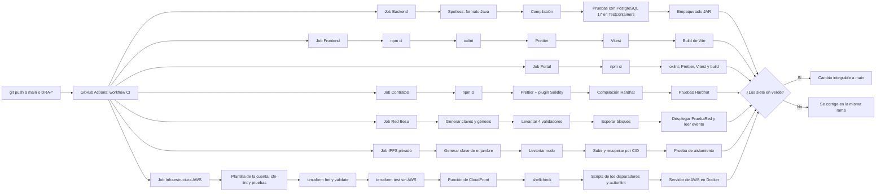

# Integración continua

- **Tarea Jira:** DRA-43
- **Configuración:** [`.github/workflows/ci.yml`](../../.github/workflows/ci.yml)
- **Resultados:** pestaña **Actions** del repositorio (https://github.com/Garyn14/TESIS_FERNANDO/actions)

## 1. Propósito

La integración continua (CI) comprueba de forma automática que cada cambio subido al repositorio compila, respeta el formato acordado y pasa sus pruebas. Así `main` siempre queda en un estado funcional y cada incremento del sprint se integra sin errores con los anteriores, que es uno de los criterios de culminación de la sección 3.2.4.5 de la tesis.

## 2. Cuándo se ejecuta

| Evento | Ramas |
|---|---|
| `push` | `main` y cualquier rama que empiece con `DRA-` (por ejemplo `DRA-14-login-por-rol`) |
| `pull_request` | Cualquier pull request hacia el repositorio |

Una ejecución completa tarda unos 2 minutos. Los jobs más lentos son el de la red Besu, que levanta 4 nodos, y el del backend, que levanta un PostgreSQL real para las pruebas.

## 3. Flujo

Los siete jobs corren **en paralelo** y son independientes: si falla uno, los otros terminan igual y se ve qué parte del proyecto tiene el problema.

## 4. Qué valida cada job

### Backend (Java + Spring Boot)

| Paso | Comando | Qué asegura |
|---|---|---|
| Preparación | `actions/setup-java@v5` (Temurin 21) con caché de Maven | Misma versión de Java que en desarrollo (ADR-001) |
| Formato, compilación y pruebas | `./mvnw -B verify` | **Spotless** falla si el código no sigue el formato de Google Java Format. Compila con Java 21 y ejecuta las pruebas de JUnit. Las pruebas levantan un **PostgreSQL 17 real con Testcontainers**, así se validan las migraciones de Flyway contra el mismo motor que se usa en producción. |

### Frontend (React + Vite)

| Paso | Comando | Qué asegura |
|---|---|---|
| Instalación | `npm ci` | Instala exactamente las versiones de `package-lock.json` |
| Linter | `npm run lint` (oxlint) | Errores comunes de React y TypeScript |
| Formato | `npm run format:check` (Prettier) | Formato uniforme |
| Pruebas | `npm test` (Vitest + Testing Library) | Comportamiento de los componentes |
| Build | `npm run build` | Revisión de tipos de TypeScript y build de producción de Vite |

### Contratos (Hardhat)

| Paso | Comando | Qué asegura |
|---|---|---|
| Instalación | `npm ci` | Versiones exactas de Hardhat y OpenZeppelin |
| Formato | `npm run format:check` | Formato uniforme, incluido Solidity (`prettier-plugin-solidity`) |
| Compilación | `npm run compile` | El contrato compila con Solidity 0.8.30 |
| Pruebas | `npm test` | Pruebas del contrato en la red simulada de Hardhat |

### Red Besu (QBFT, 4 validadores)

Agregado en DRA-45.

| Paso | Comando | Qué asegura |
|---|---|---|
| Generar la red | `plataforma/infra/besu/generar-red.sh` | Claves de 4 validadores, génesis QBFT y lista de nodos permitidos, nuevas en cada ejecución |
| Levantar nodos | `docker compose --profile besu up -d besu-nodo1 … besu-nodo4` | La configuración de `docker-compose.yml` arranca |
| Esperar bloques | Consulta `eth_blockNumber` hasta el bloque 3 (máximo 2 minutos) | El consenso QBFT funciona entre los 4 nodos |
| Prueba de humo | `npm run probar:besu` (`scripts/probar-red-besu.ts`) | `chainId` 20260; 4 validadores; una cuenta nueva **sin saldo** despliega `PruebaRed.sol` y envía una transacción con `gasPrice` 0; el evento se lee y el saldo sigue en 0 (RNF11) |
| Contrato de la plataforma | `npm run probar:registro` (`scripts/probar-registro-besu.ts`) | Agregado en DRA-17: `RegistroDocumentos` se despliega con dos administradores; el Administrador otorga el rol de firmante y el respaldo lo revoca, en la red real y sin saldo |
| Si falla | `docker compose logs` | Deja en el registro los últimos mensajes de los nodos |

### IPFS privado

Agregado en DRA-46.

| Paso | Comando | Qué asegura |
|---|---|---|
| Generar la clave | `plataforma/infra/ipfs/generar-clave.sh` | Clave de enjambre nueva en cada ejecución |
| Levantar el nodo | `docker compose --profile ipfs up -d --wait ipfs` | El nodo arranca en modo privado (`LIBP2P_FORCE_PNET=1`) |
| Prueba de humo | `./ipfs/probar-ipfs.sh` | 0 nodos de arranque y 0 pares; un archivo subido con CIDv1 se recupera idéntico y queda fijado |
| Aislamiento | `./ipfs/probar-aislamiento.sh` | Un nodo sin la clave es rechazado y uno con la misma clave se conecta (RNF03) |
| Si falla | `docker compose logs` | Deja en el registro los últimos mensajes del nodo |

## 5. Cómo leer un resultado

1. En GitHub, abre la pestaña **Actions** o el ícono ✓/✗ que aparece junto a cada commit.
2. Cada ejecución muestra los cinco jobs. Uno en rojo indica qué parte falló.
3. Al entrar al job se ve el paso exacto que falló y su registro.
4. Con **GitHub for Jira** instalado, el estado del build también aparece dentro de cada historia en Jira.

## 6. Qué hacer si falla

Se reproduce en local con el mismo comando del paso que falló y se corrige en la misma rama:

| Falla en | Reproducir | Corrección habitual |
|---|---|---|
| Formato del backend | `./mvnw spotless:check` | `./mvnw spotless:apply` |
| Pruebas del backend | `./mvnw verify` (requiere Docker) | Revisar `target/surefire-reports/` |
| Linter o formato del frontend | `npm run lint` / `npm run format:check` | `npm run format` |
| Pruebas del frontend | `npm test` | — |
| Contratos | `npm run compile` / `npm test` | `npm run format` para el formato |
| Red Besu | `./besu/generar-red.sh` + `docker compose --profile besu up -d` + `npm run probar:besu` | Revisar `docker compose --profile besu logs` |
| IPFS privado | `./ipfs/generar-clave.sh` + `docker compose --profile ipfs up -d` + `./ipfs/probar-ipfs.sh` | Revisar `docker compose --profile ipfs logs` |

Un cambio no se integra a `main` mientras alguno de los jobs esté en rojo.

## 7. Decisiones

| Decisión | Motivo |
|---|---|
| Un solo workflow con tres jobs en paralelo | Es más simple de mantener y da una vista única del estado del proyecto |
| Testcontainers con PostgreSQL 17 en lugar de una base en memoria (H2) | Las migraciones de Flyway y las consultas se prueban contra el mismo motor de producción |
| Maven Wrapper (`mvnw`) | Fija la versión de Maven (3.9.16) sin que haya que instalarla en el runner ni en local |
| `npm ci` con `package-lock.json` | Builds reproducibles con las mismas versiones en CI y en local |
| Compilar el contrato en CI | El compilador de Solidity se descarga en el runner de GitHub. En entornos con la red restringida esa descarga puede estar bloqueada, y la CI queda como la verificación de referencia |
| Actions en `@v5` (`checkout`, `setup-java`, `setup-node`) | Las versiones `@v4` usan Node.js 20, que GitHub marcó como obsoleto |

## 8. Evidencia (para el Capítulo III)

| Fecha | Ejecución | Rama | Resultado |
|---|---|---|---|
| 29/10/2026 | [40792393119](https://github.com/Garyn14/TESIS_FERNANDO/actions/runs/40792393119) | `DRA-43-estructura-ci` | ✓ Los tres jobs en verde (con avisos de actions obsoletas) |
| 29/10/2026 | [40792574492](https://github.com/Garyn14/TESIS_FERNANDO/actions/runs/40792574492) | `DRA-43-estructura-ci` | ✓ Los tres jobs en verde, sin avisos, tras actualizar a `@v5` |
| 29/10/2026 | [40797880888](https://github.com/Garyn14/TESIS_FERNANDO/actions/runs/40797880888) | `DRA-45-red-besu` | ✓ Cuatro jobs en verde, incluido el nuevo job Red Besu |
| 29/10/2026 | [40814310340](https://github.com/Garyn14/TESIS_FERNANDO/actions/runs/40814310340) | `DRA-46-ipfs-privado` | ✓ Cinco jobs en verde, incluido el nuevo job IPFS privado |
| 29/10/2026 | [40898899824](https://github.com/Garyn14/TESIS_FERNANDO/actions/runs/40898899824) | `DRA-12-crear-cuentas` | ✓ Cinco jobs en verde con la primera historia (HU01) |
| 29/10/2026 | [40903595082](https://github.com/Garyn14/TESIS_FERNANDO/actions/runs/40903595082) | `DRA-13-editar-desactivar-cuentas` | ✓ Cinco jobs en verde con HU02 |
| 29/10/2026 | [40913715547](https://github.com/Garyn14/TESIS_FERNANDO/actions/runs/40913715547) | `DRA-14-inicio-de-sesion` | ✓ Cinco jobs en verde con HU03 (53 pruebas de backend, 31 de frontend) |
| 29/10/2026 | [40928314920](https://github.com/Garyn14/TESIS_FERNANDO/actions/runs/40928314920) | `DRA-15-cambiar-restablecer-contrasena` | ✓ Cinco jobs en verde con HU04 (63 pruebas de backend, 44 de frontend) |
| 29/10/2026 | [40940857854](https://github.com/Garyn14/TESIS_FERNANDO/actions/runs/40940857854) | `DRA-16-area-de-usuario` | ✓ Cinco jobs en verde con HU05 (74 pruebas de backend, 49 de frontend) |
| 29/10/2026 | [40944693594](https://github.com/Garyn14/TESIS_FERNANDO/actions/runs/40944693594) | `DRA-17-billetera-y-firmante` | ✓ Cinco jobs en verde con HU06: contrato compilado con el compilador oficial, 15 pruebas de Hardhat y RegistroDocumentos probado en la red Besu real (92 pruebas de backend, 59 de frontend) |
| 01/11/2026 | [41333365036](https://github.com/Garyn14/TESIS_FERNANDO/actions/runs/41333365036) | `DRA-18-tipo-de-documento` | ✓ Cinco jobs en verde con HU07, la primera del Sprint 2 (99 pruebas de backend, 66 de frontend) |
| 01/11/2026 | [41335816519](https://github.com/Garyn14/TESIS_FERNANDO/actions/runs/41335816519) | `DRA-19-solicitud-de-parte` | ✓ Cinco jobs en verde con HU08: migración V10 de documentos validada contra PostgreSQL 17 real (111 pruebas de backend, 76 de frontend) |
| 01/11/2026 | [41347416010](https://github.com/Garyn14/TESIS_FERNANDO/actions/runs/41347416010) | `DRA-20-emision-por-lista` | ✓ Cinco jobs en verde con HU09: migración V11 de lotes y lectura de Excel con Apache POI (123 pruebas de backend, 85 de frontend) |
| 03/11/2026 | [41677224185](https://github.com/Garyn14/TESIS_FERNANDO/actions/runs/41677224185) | `DRA-19-fechas-dia-mes-anio` | ✓ Cinco jobs en verde con la corrección de la revisión del Sprint 2: fechas en día/mes/año (123 pruebas de backend, 90 de frontend) |
| 03/11/2026 | [41743421533](https://github.com/Garyn14/TESIS_FERNANDO/actions/runs/41743421533) | `DRA-21-por-revisar` | ✓ Cinco jobs en verde con HU10, la primera del Sprint 3: migración V12 y revisión atómica (129 pruebas de backend, 95 de frontend) |
| 03/11/2026 | [41745602040](https://github.com/Garyn14/TESIS_FERNANDO/actions/runs/41745602040) | `DRA-24-pdf-final` | ✓ Cinco jobs en verde con HU16: PDF final con OpenPDF, QR con ZXing y SHA-256 (135 pruebas de backend, 95 de frontend) |
| 03/11/2026 | [41749276488](https://github.com/Garyn14/TESIS_FERNANDO/actions/runs/41749276488) | `DRA-25-almacenar-pdf-ipfs` | ✓ Cinco jobs en verde con HU17: migración V13 y PDF final en IPFS, con pruebas del backend contra un nodo Kubo real en Testcontainers (142 pruebas de backend, 97 de frontend) |
| 03/11/2026 | [41753614314](https://github.com/Garyn14/TESIS_FERNANDO/actions/runs/41753614314) | `DRA-22-firmar-documentos` | ✓ Cinco jobs en verde con HU11: `registrarDocumentos` en el contrato (22 pruebas de Hardhat y 50 documentos en una transacción en la red Besu real), migración V14 y firma con la billetera (154 pruebas de backend, 107 de frontend) |
| 03/11/2026 | [41758193909](https://github.com/Garyn14/TESIS_FERNANDO/actions/runs/41758193909) | `DRA-23-firmar-lote` | ✓ Cinco jobs en verde con HU12: migración V15, observar y rechazar certificados de un lote y firmar el resto (158 pruebas de backend, 113 de frontend) |
| 04/11/2026 | [41779637849](https://github.com/Garyn14/TESIS_FERNANDO/actions/runs/41779637849) | `DRA-26-sincronizar-blockchain` | ✓ Cinco jobs en verde con HU18, la última del Sprint 3: migración V16 y sincronización con los eventos del contrato (164 pruebas de backend, 113 de frontend) |
| 04/11/2026 | [41784094378](https://github.com/Garyn14/TESIS_FERNANDO/actions/runs/41784094378) | `DRA-27-observar-documento` | ✓ Cinco jobs en verde con HU13, la primera del Sprint 4: observar un documento y migración V17 (168 pruebas de backend, 114 de frontend) |
| 04/11/2026 | [41786330073](https://github.com/Garyn14/TESIS_FERNANDO/actions/runs/41786330073) | `DRA-28-rechazar-documento` | ✓ Cinco jobs en verde con HU14: rechazar un documento (171 pruebas de backend, 115 de frontend) |
| 04/11/2026 | [41789172913](https://github.com/Garyn14/TESIS_FERNANDO/actions/runs/41789172913) | `DRA-29-corregir-y-reenviar` | ✓ Cinco jobs en verde con HU15: corregir y reenviar un observado, migración V18 (175 pruebas de backend, 120 de frontend) |
| 04/11/2026 | [41793444955](https://github.com/Garyn14/TESIS_FERNANDO/actions/runs/41793444955) | `DRA-30-anular-documento` | ✓ Cinco jobs en verde con HU29: anular un documento firmado, `anularDocumento` en el contrato y migración V19 (25 pruebas del contrato, 181 de backend, 124 de frontend) |
| 04/11/2026 | [41841771480](https://github.com/Garyn14/TESIS_FERNANDO/actions/runs/41841771480) | `DRA-31-reemitir-documento` | ✓ Cinco jobs en verde con HU30: reemitir un documento firmado, `registrarReemisiones` en el contrato (50 reemisiones en una transacción en Besu) y migración V20 (28 pruebas del contrato, 186 de backend, 130 de frontend). El primer intento se canceló porque el paso del contrato en Besu quedó colgado sin salida (antes había tardado 14 s); el segundo intento pasó completo |
| 04/11/2026 | [41897054361](https://github.com/Garyn14/TESIS_FERNANDO/actions/runs/41897054361) | `DRA-43-timeout-ci` | ✓ Cinco jobs en verde con límite de tiempo: `timeout-minutes` de 10 a 15 por job y de 5 en los dos pasos que usan la red Besu, para que un cuelgue falle rápido en lugar de consumir hasta 6 horas |
| 05/11/2026 | [41967370698](https://github.com/Garyn14/TESIS_FERNANDO/actions/runs/41967370698) | `DRA-34-comprobar-autenticidad` | ✓ Cinco jobs en verde con HU21, la primera del Sprint 5: comprobación de autenticidad con el contrato y el PDF en IPFS, y su API pública (191 pruebas de backend, 130 de frontend, 28 del contrato) |
| 05/11/2026 | [41969603568](https://github.com/Garyn14/TESIS_FERNANDO/actions/runs/41969603568) | `DRA-32-verificar-con-qr` | ✓ **Seis** jobs en verde con HU19: portal público de verificación (job nuevo "Portal (React + Vite)"), la ruta del QR y el documento verificado (192 pruebas de backend, 6 del portal, 130 de frontend, 28 del contrato) |
| 05/11/2026 | [41972278652](https://github.com/Garyn14/TESIS_FERNANDO/actions/runs/41972278652) | `DRA-33-verificar-con-codigo` | ✓ Seis jobs en verde con HU20, la última del Sprint 5: verificación con el código y límite de 10 consultas por minuto por IP con Bucket4j (195 pruebas de backend, 11 del portal, 130 de frontend, 28 del contrato) |
| 08/11/2026 | [42438087410](https://github.com/Garyn14/TESIS_FERNANDO/actions/runs/42438087410) | `DRA-35-buscar-documentos` | ✓ Seis jobs en verde con HU22, la primera del Sprint 6: Buscar documentos para Mesa de Partes, por nombre, DNI, código, expediente o lote y con filtros por estado (205 pruebas de backend, 11 del portal, 139 de frontend, 28 del contrato) |
| 08/11/2026 | [42439796088](https://github.com/Garyn14/TESIS_FERNANDO/actions/runs/42439796088) | `DRA-36-estado-de-un-documento` | ✓ Seis jobs en verde con HU23: ficha de un documento para Mesa de Partes, con su estado explicado, sus datos básicos y las reemisiones enlazadas (211 pruebas de backend, 11 del portal, 153 de frontend, 28 del contrato) |
| 08/11/2026 | [42441312094](https://github.com/Garyn14/TESIS_FERNANDO/actions/runs/42441312094) | `DRA-37-historial-y-auditoria` | ✓ Seis jobs en verde con HU24: historial con fecha, hora y responsable y detalle técnico de auditoría plegado, en la ficha del documento (217 pruebas de backend, 11 del portal, 161 de frontend, 28 del contrato) |
| 08/11/2026 | [42443272623](https://github.com/Garyn14/TESIS_FERNANDO/actions/runs/42443272623) | `DRA-38-descargar-o-imprimir` | ✓ Seis jobs en verde con HU25: ver, descargar e imprimir el PDF firmado comprobado con la blockchain, duplicados en el historial (V21) y filtro Listos para entregar (224 pruebas de backend, 11 del portal, 168 de frontend, 28 del contrato) |
| 08/11/2026 | [42444614347](https://github.com/Garyn14/TESIS_FERNANDO/actions/runs/42444614347) | `DRA-39-aviso-pendiente-al-director` | ✓ Seis jobs en verde con HU26: avisos dentro de la plataforma (V22) y aviso al Director de cada documento o lote pendiente, con la campana del encabezado (230 pruebas de backend, 11 del portal, 180 de frontend, 28 del contrato) |
| 08/11/2026 | [42446007661](https://github.com/Garyn14/TESIS_FERNANDO/actions/runs/42446007661) | `DRA-40-avisos-al-area` | ✓ Seis jobs en verde con HU27: avisos de firmado, observado, rechazado y anulado al Área encargada, con el motivo y un solo aviso por lote (V23) (236 pruebas de backend, 11 del portal, 180 de frontend, 28 del contrato) |
| 08/11/2026 | [42448485785](https://github.com/Garyn14/TESIS_FERNANDO/actions/runs/42448485785) | `DRA-41-avisos-a-mesa-de-partes` | ✓ Seis jobs en verde con HU28, la última del Sprint 6: avisos Listo para entregar y Rechazado (con expediente y motivo) a Mesa de Partes (240 pruebas de backend, 11 del portal, 180 de frontend, 28 del contrato) |
| 08/11/2026 | [42483487092](https://github.com/Garyn14/TESIS_FERNANDO/actions/runs/42483487092) | `DRA-49-dependabot` | ✓ Seis jobs en verde con DRA-49: configuración de Dependabot y nota sobre las pruebas con Besu, sin cambios de código (240 pruebas de backend, 11 del portal, 180 de frontend, 28 del contrato) |
| 08/11/2026 | [42485036386](https://github.com/Garyn14/TESIS_FERNANDO/actions/runs/42485036386) | `DRA-50-actualizaciones-dependabot` | ✓ Seis jobs en verde con DRA-50: primeras actualizaciones de Dependabot (acciones de la CI, hardhat, menores del backend, del frontend y del portal, jsdom 31) y el formato del Spotless 3.11. Pruebas de punta a punta de los Sprints 1 a 6 con 32, 23, 34, 32, 17 y 30 pasos (240 pruebas de backend, 11 del portal, 180 de frontend, 28 del contrato) |
| 08/11/2026 | [42489409504](https://github.com/Garyn14/TESIS_FERNANDO/actions/runs/42489409504) | `DRA-51-plantilla-qa` | ✓ **Siete jobs** en verde con DRA-51: plantilla de QA en AWS con Terraform y el nuevo job "Infraestructura AWS (Terraform y servidor)", con 6 pruebas de la plantilla (`terraform test`, sin cuenta de AWS) y 16 comprobaciones del servidor en Docker (nginx, `/rpc`, HU20 y persistencia). El mensaje del commit dice 17 comprobaciones por error: el registro muestra 16 (240 pruebas de backend, 11 del portal, 180 de frontend, 28 del contrato) |
| 08/11/2026 | [42492338983](https://github.com/Garyn14/TESIS_FERNANDO/actions/runs/42492338983) | `DRA-54-cloudfront` | ✓ Siete jobs en verde con DRA-54: CloudFront para QA. En el job Infraestructura AWS: 9 pruebas de la plantilla (`terraform test`), 4 de la función de rutas del portal (`node --test`) y 16 comprobaciones del servidor. Fuera de la CI, los Sprints 1 a 6 contra el servidor de AWS en Docker detrás de un CloudFront simulado: 32, 23, 34, 32, 17 y 30 pasos, más 7 comprobaciones de CloudFront y del aviso de apagado (240 pruebas de backend, 11 del portal, 180 de frontend, 28 del contrato) |
| 08/11/2026 | [42500364211](https://github.com/Garyn14/TESIS_FERNANDO/actions/runs/42500364211) | `DRA-52-disparadores-qa` | ✓ Siete jobs en verde con DRA-52: disparadores QA – Encender, Apagar y Destruir. En el job Infraestructura AWS: 9 pruebas de la plantilla, 4 de la función del portal, 15 comprobaciones de los scripts de los disparadores con un `aws` simulado, actionlint sin observaciones y 16 comprobaciones del servidor (240 pruebas de backend, 11 del portal, 180 de frontend, 28 del contrato) |
| 08/11/2026 | [42501095760](https://github.com/Garyn14/TESIS_FERNANDO/actions/runs/42501095760) | `DRA-53-cuenta-y-presupuesto` | ✓ Siete jobs en verde con DRA-53: plantilla de la cuenta (OIDC, bucket del estado y presupuesto) y guía de despliegue. En el job Infraestructura AWS: cfn-lint y 10 pruebas de la plantilla de la cuenta, 10 pruebas de la plantilla de Terraform, 4 de la función del portal, los scripts de los disparadores y el servidor en Docker (240 pruebas de backend, 11 del portal, 180 de frontend, 28 del contrato) |
| 08/11/2026 | [42507905036](https://github.com/Garyn14/TESIS_FERNANDO/actions/runs/42507905036) | `DRA-55-region-us-east-2` | ✓ Siete jobs en verde con DRA-55: QA en us-east-2 y guía para la cuenta de la experiencia nueva de AWS. El primer intento no arrancó porque se agotaron los 2 000 minutos mensuales de Actions del plan gratuito para repositorios privados. Se volvió a ejecutar tras hacer **público** el repositorio, donde los minutos son gratuitos (10 pruebas de la plantilla de la cuenta, 10 de Terraform, 4 de la función del portal, scripts de los disparadores y servidor en Docker; 240 pruebas de backend, 11 del portal, 180 de frontend, 28 del contrato) |
| 08/11/2026 | [42514223997](https://github.com/Garyn14/TESIS_FERNANDO/actions/runs/42514223997) | `DRA-56-acceso-github-iam` | ✓ Siete jobs en verde con DRA-56: acceso de GitHub con un usuario de IAM en lugar de OIDC. En el job Infraestructura AWS: 11 pruebas de la plantilla de la cuenta (cfn-lint sin observaciones), 10 de Terraform, 4 de la función del portal, scripts de los disparadores y servidor en Docker (240 pruebas de backend, 11 del portal, 180 de frontend, 28 del contrato) |
| 08/11/2026 | [42515883755](https://github.com/Garyn14/TESIS_FERNANDO/actions/runs/42515883755) | `DRA-56-acceso-github-iam` | ✓ Siete jobs en verde con la corrección de los disparadores: el primer **QA – Encender** real ([42515701053](https://github.com/Garyn14/TESIS_FERNANDO/actions/runs/42515701053)) falló porque los pasos corrían en `plataforma/` antes de descargar el código. Ahora el primer paso de cada flujo es la descarga, y `probar-acciones.sh` lo comprueba (18 comprobaciones; 240 pruebas de backend, 11 del portal, 180 de frontend, 28 del contrato) |
| 08/11/2026 | [42516408557](https://github.com/Garyn14/TESIS_FERNANDO/actions/runs/42516408557) | `DRA-56-acceso-github-iam` | ✓ Siete jobs en verde con la segunda corrección del primer encendido. El encendido [42516176672](https://github.com/Garyn14/TESIS_FERNANDO/actions/runs/42516176672) falló porque AWS rechazó una descripción con tildes, y porque el plan gratuito no permite el t4g.medium. Hay una nueva prueba de Terraform, `descripciones_que_acepta_aws`, con 11 pruebas en total (240 pruebas de backend, 11 del portal, 180 de frontend, 28 del contrato) |
| 08/11/2026 | [42518732294](https://github.com/Garyn14/TESIS_FERNANDO/actions/runs/42518732294) | `DRA-56-acceso-github-iam` | ✓ Siete jobs en verde con la tercera corrección del primer encendido: créditos de CPU `unlimited` y más margen para que arranque Besu. En el encendido [42517577853](https://github.com/Garyn14/TESIS_FERNANDO/actions/runs/42517577853) el servidor arrancó sin créditos y quedó limitado al 20 % (11 pruebas de Terraform; 240 de backend, 11 del portal, 180 de frontend, 28 del contrato) |
| 08/11/2026 | [42522889153](https://github.com/Garyn14/TESIS_FERNANDO/actions/runs/42522889153) | `DRA-57-guion-qa` | ✓ Siete jobs en verde con DRA-57: guion de pruebas de punta a punta en QA. Es un cambio solo de documentación (240 pruebas de backend, 11 del portal, 180 de frontend, 28 del contrato) |
| 11/11/2026 | [42963593056](https://github.com/Garyn14/TESIS_FERNANDO/actions/runs/42963593056) | `DRA-64-apagado-fuera-de-horario` | ✓ Siete jobs en verde con DRA-64: el apagado programado de QA pasa a las 00:17 de Lima y no apaga fuera de la madrugada. Las comprobaciones de los disparadores suben de 18 a 26; las del servidor siguen en 16 (11 pruebas de Terraform, 11 de la plantilla de la cuenta y 4 de la función de CloudFront; 240 de backend, 11 del portal, 180 de frontend, 28 del contrato) |
| 11/11/2026 | [42968075589](https://github.com/Garyn14/TESIS_FERNANDO/actions/runs/42968075589) | `DRA-59-renombrar-roles` | ✓ Siete jobs en verde con DRA-59 (Sprint 7): los roles se llaman "Emisor de área" y "Mesa de Partes" (migración V24). El backend pasa de 240 a 241 pruebas por la prueba nueva de los nombres de los roles (11 del portal, 180 de frontend, 28 del contrato; infraestructura sin cambios: 11 de Terraform, 11 de la cuenta, 4 de CloudFront, 26 de los disparadores y 16 del servidor) |
| 11/11/2026 | [42971967758](https://github.com/Garyn14/TESIS_FERNANDO/actions/runs/42971967758) | `DRA-60-areas-y-documentos` | ✓ Siete jobs en verde con DRA-60 (Sprint 7): pantalla "Áreas y documentos" (migración V25) y la corrección y la reemisión validan con el tipo del propio documento. El backend pasa de 241 a 249 pruebas (`ConfiguracionDeAreasTest` y `TipoQuitadoDelAreaTest`) y el frontend, de 180 a 186 (`PaginaAreas.test.tsx`); portal 11 y contrato 28; infraestructura sin cambios (11 de Terraform, 11 de la cuenta, 4 de CloudFront, 26 de los disparadores y 16 del servidor) |
| 11/11/2026 | [43039211874](https://github.com/Garyn14/TESIS_FERNANDO/actions/runs/43039211874) | `DRA-61-gestionar-areas` | ✓ Siete jobs en verde con DRA-61 (Sprint 7): crear, renombrar, deshabilitar y reactivar áreas (migración V26). El backend pasa de 249 a 260 pruebas (`GestionDeAreasTest` y `AreaDeshabilitadaTest`) y el frontend, de 186 a 191 (`PaginaAreas.test.tsx`); portal 11 y contrato 28; infraestructura sin cambios (11 de Terraform, 11 de la cuenta, 4 de CloudFront, 26 de los disparadores y 16 del servidor). La ejecución anterior ([43038284554](https://github.com/Garyn14/TESIS_FERNANDO/actions/runs/43038284554)) falló en `AreaDeUsuarioTest`: según el orden de las clases, las áreas creadas por las pruebas seguían activas; ahora quedan deshabilitadas al restaurar |
| 11/11/2026 | [43052543667](https://github.com/Garyn14/TESIS_FERNANDO/actions/runs/43052543667) | `DRA-58-mesa-de-partes-de-area` | ✓ Siete jobs en verde con DRA-58 (Sprint 7): rol "Mesa de Partes de área" y la columna `rol.limitado_al_area` (migración V27). El backend pasa de 260 a 266 pruebas (`MesaDePartesDeAreaTest`) y el frontend, de 191 a 192 (`FormularioCuenta.test.tsx`); portal 11 y contrato 28; infraestructura sin cambios (11 de Terraform, 11 de la cuenta, 4 de CloudFront, 26 de los disparadores y 16 del servidor) |
| 11/11/2026 | [43076723574](https://github.com/Garyn14/TESIS_FERNANDO/actions/runs/43076723574) | `DRA-62-vigencia-de-documentos` | ✓ Siete jobs en verde con DRA-62 (Sprint 7): vigencia opcional por tipo de documento, con la fecha impresa en el PDF y contrastada al verificar (migración V28). El backend pasa de 266 a 272 pruebas (`VigenciaDeDocumentosTest`), el frontend de 192 a 199 y el portal de 11 a 13; contrato 28; infraestructura sin cambios (11 de Terraform, 11 de la cuenta, 4 de CloudFront, 26 de los disparadores y 16 del servidor) |

## 9. Pendientes

- ~~Instalar **GitHub for Jira**~~: instalado el 29/10/2026 (DRA-43).
- Pruebas de integración del backend contra Besu e IPFS:
  - **IPFS:** cubierto desde HU17, con un nodo Kubo real en Testcontainers, dentro del job Backend.
  - **Besu:** en la CI, el backend usa un contrato simulado (`ContratoFalso`). `ContratoRegistroWeb3jTest` lee recibos de transacción sin red, y el job "Red Besu (QBFT, 4 validadores)" solo comprueba que la red levanta y produce bloques.
  - La integración real con Besu (firmas, anulaciones, reemisiones y verificación, con transacciones de la billetera del Director) se prueba en las **pruebas de punta a punta** de los Sprints 3 a 6, que corren localmente con `./e2e/regresion.sh N` y no en la CI.
  - **Pendiente:** llevar a la CI una prueba de punta a punta contra la red Besu. Es costosa (unos 5 minutos por ejecución) y por ahora se registra en la evidencia de cada historia.
- ~~Agregar análisis de dependencias vulnerables (Dependabot)~~: agregado el 08/11/2026 (DRA-49) en `.github/dependabot.yml`. Cada lunes revisa las dependencias del backend (Maven), del frontend, el portal, los contratos y las pruebas de punta a punta (npm), las acciones de la CI y las imágenes de Docker de `plataforma/infra`. Las **alertas de seguridad** (dependencias vulnerables) no dependen de este archivo: se activan en GitHub, en *Settings → Code security → Dependabot alerts* y *Dependabot security updates*. Esa activación la hace el dueño del repositorio. Cada actualización que propone se revisa e integra por separado, con la CI en verde y, si toca el PDF, el QR o el portal, con las pruebas de punta a punta. `@types/node` se mantiene en la versión de Node 22. Las primeras 13 solicitudes se resolvieron en DRA-50: 7 aceptadas, 3 cerradas (@types/node) y 3 pospuestas hasta después de la validación del PO (OpenPDF 3, Apache POI 6 y TypeScript 7).
