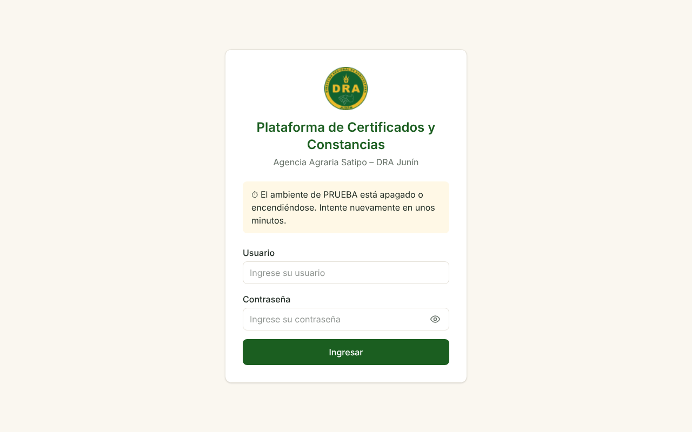
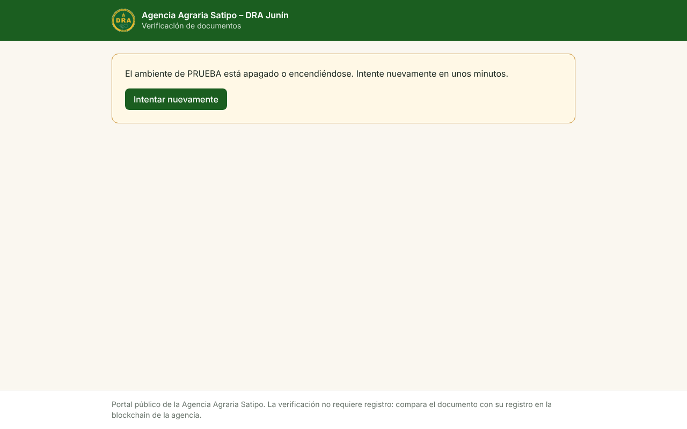
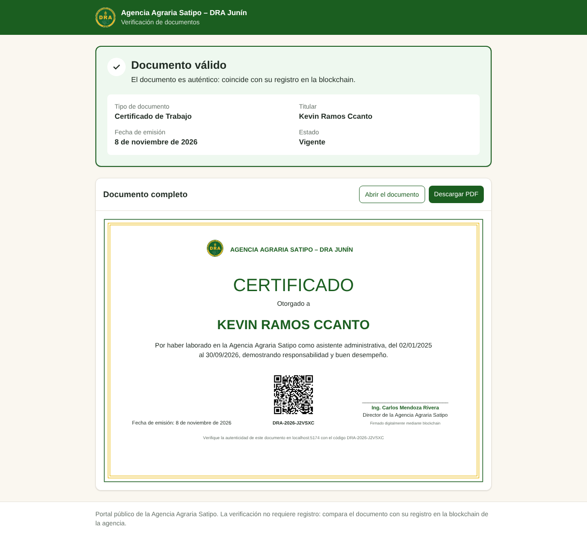
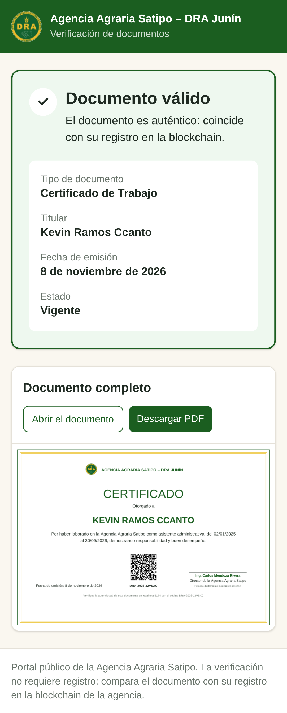

# DRA-54 · QA en AWS: direcciones fijas con HTTPS mediante CloudFront

**Tarea padre:** DRA-44 · **Rama:** `DRA-54-cloudfront` · **Fecha:** 08/11/2026

## Qué se construyó

| Pieza | Archivo |
|---|---|
| Dos distribuciones de CloudFront (plataforma y portal), con S3 privado mediante Origin Access Control y el servidor como segundo origen | `plataforma/infra/aws/modulos/ambiente/cloudfront.tf` |
| Función de CloudFront del portal: `/verificar/{token}` y las demás rutas sin extensión se sirven con `index.html` | `modulos/ambiente/rutas-del-portal.js` |
| Aviso de servidor apagado: 502 y 504 se reemplazan por `/_estado/apagado.json` con estado 503 | `cloudfront.tf` (`custom_error_response` y `aws_s3_object`) |
| `PLATAFORMA_PORTAL_URL` (QR) y `BESU_RPC_PUBLICA` (MetaMask) en Parameter Store, con las direcciones de CloudFront | `cloudfront.tf` |
| CloudFront simulado (nginx) para las pruebas locales | `plataforma/infra/aws/pruebas/cloudfront-local.conf.template`, `origen.inc.template`, `docker-compose.prueba.yml` |
| Sprints 1 a 6 contra el servidor de AWS en Docker, detrás del CloudFront simulado | `pruebas/de-punta-a-punta.sh` |
| Rutas de CloudFront y aviso de apagado | `pruebas/cloudfront.cjs` |

Las pruebas de punta a punta ahora leen el nombre de los contenedores de PostgreSQL e IPFS desde variables (`E2E_CONTENEDOR_PG` y `E2E_CONTENEDOR_IPFS`). Por defecto siguen usando los de `levantar.sh`. Es un cambio menor de las pruebas y no lleva ticket propio.

## Qué se comprueba

### 1. Plantilla (`terraform test`, sin cuenta de AWS): 3 pruebas nuevas, 9 en total

- `cloudfront_rutas_y_cache`:
  - la plataforma envía al servidor `/api/*` y `/rpc`;
  - el portal envía solo `/api/verificacion/*`;
  - las rutas al servidor no usan caché y solo aceptan HTTPS;
  - las pantallas pasan siempre a HTTPS;
  - solo el portal reescribe sus rutas.
- `cloudfront_llega_al_servidor_con_el_secreto`:
  - las dos distribuciones agregan `X-Origen-Secreto`;
  - 502 y 504 entregan el aviso con estado 503;
  - el aviso dice "El ambiente de QA está apagado".
- `direcciones_para_el_backend`: las dos direcciones van a `/dra-satipo/qa/`.

### 2. Función del portal (`node --test`): 4 pruebas

- El enlace del QR y la portada se sirven con la aplicación.
- Los archivos del build (`.js`, `.css`, `.svg`) pasan tal cual.
- La función no usa módulos, que el entorno de CloudFront no admite.

### 3. De punta a punta: los 6 sprints contra el servidor de AWS, detrás del CloudFront simulado

Cada sprint corre en un **servidor nuevo**, armado con el mismo paquete que se despliega en el EC2:
- el contrato se despliega **por `/rpc`**;
- la billetera de prueba del Director firma **por `/rpc`**, como MetaMask en QA;
- el QR apunta al portal simulado.

| Sprint | Resultado |
|---|---|
| 1 | 32 pasos correctos |
| 2 | 23 pasos correctos |
| 3 | 34 pasos correctos |
| 4 | 32 pasos correctos |
| 5 | 17 pasos correctos (en la segunda corrida; ver "Ajustes") |
| 6 | 30 pasos correctos |
| CloudFront | 7 pasos correctos |

Comprobaciones de CloudFront (`cloudfront.cjs`):

```
✓ Portal: el enlace del QR (/verificar/{token}) carga la aplicación
✓ Portal: solo publica /api/verificacion; el resto de la API no llega al servidor
✓ Plataforma: /api y /rpc llegan al servidor; un archivo inexistente no
✓ Servidor apagado: la API responde 503 con el aviso en el formato del backend
✓ Servidor apagado: la plataforma carga y muestra el aviso en el inicio de sesión
✓ Servidor apagado: el portal carga y muestra el aviso al verificar
✓ Servidor encendido de nuevo: la plataforma vuelve a responder
```

Plataforma con el servidor apagado: el aviso aparece en el inicio de sesión, sin cambios en el código del frontend.



Portal con el servidor apagado, al abrir el enlace de un QR:



HU19 a través del CloudFront simulado, con el visor del PDF (escritorio y celular):





## Decisiones

| Decisión | Por qué |
|---|---|
| Dos distribuciones y no una | El portal es público y la plataforma interna no. Cada una publica solo su parte de la API: desde el portal, `/api/usuarios` devuelve la aplicación, no la API. En PROD cada una recibirá su propio dominio. |
| El aviso de apagado es un JSON con el formato de error del backend | La plataforma y el portal ya muestran el `mensaje` de un error. Así el aviso aparece sin cambiar su código. |
| Solo 502 y 504 se reemplazan por el aviso | El backend usa 503 cuando la blockchain o IPFS no responden, con su propio mensaje (HU21). Ese 503 no se toca. |
| `PriceClass_All` | Incluye las ubicaciones de Sudamérica, más cercanas a Satipo. El tráfico de QA cabe en la capa gratuita de 1 TB. |
| Servidor apagado: el origen pasa a `servidor-apagado.invalid` | Al apagar el EC2, AWS puede dar su IP pública a otro cliente. Si CloudFront siguiera apuntando ahí, le mandaría el encabezado secreto. **DRA-52 debe volver a aplicar Terraform después de apagar.** |
| Política de cabeceras de seguridad administrada por AWS en los archivos | Agrega HSTS, `X-Content-Type-Options` y protección contra *clickjacking*, sin costo. |

## Ajustes encontrados

- **Sprint 5, HU19: el visor del PDF no cargaba.** El *worker* de pdf.js es un módulo `.mjs`, y el CloudFront simulado lo entregaba como `application/octet-stream`. El navegador rechaza un *worker* de módulo con ese tipo.
  - En AWS pasaría lo mismo si el `.mjs` se sube a S3 sin su tipo.
  - El simulador ahora lo entrega como `text/javascript`.
  - **Requisito para DRA-52:** al publicar en S3, subir los `.mjs` con `Content-Type: text/javascript` y comprobarlo.
- **Tiempo de las pruebas:** la corrida completa de los 6 sprints tarda alrededor de una hora, por eso no está en la CI. La CI sí corre las pruebas de la plantilla, de la función y del servidor.

## Pendiente en las otras subtareas

- **DRA-52:**
  - publicar el build en S3 con los tipos correctos y `index.html` con `Cache-Control: no-cache`, sin tocar `_estado/`;
  - invalidar `index.html` en las dos distribuciones;
  - volver a aplicar Terraform al apagar.
- **Primera puesta en AWS:** comprobar que CloudFront acepte `servidor-apagado.invalid` como origen. Si no lo acepta, se cambia el nombre de reserva.
