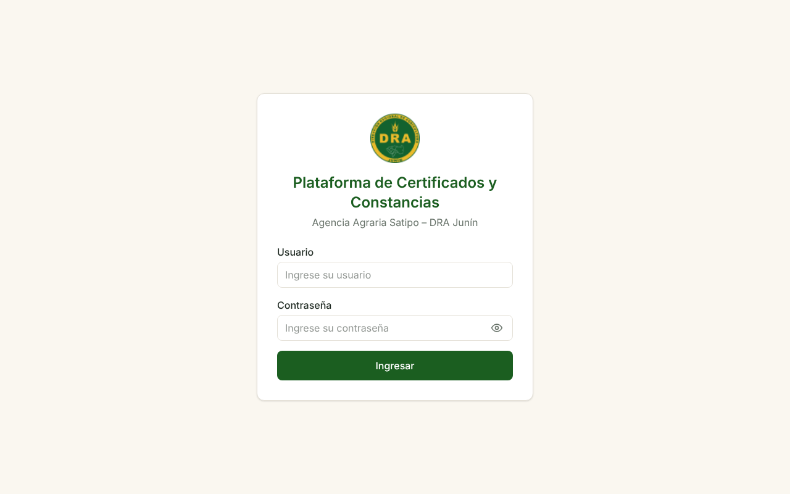
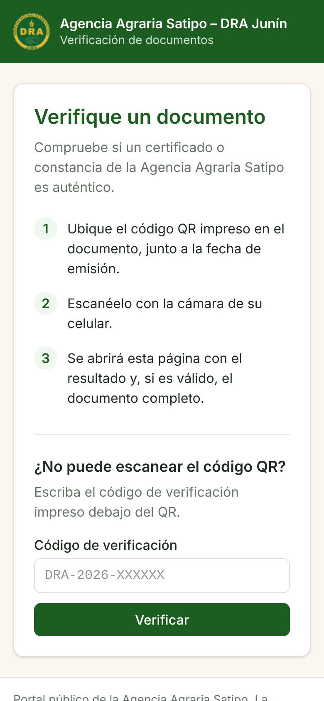

# DRA-56 · QA en AWS: acceso de GitHub con usuario de IAM y primer encendido real

**Tarea padre:** DRA-44 · **Rama:** `DRA-56-acceso-github-iam` · **Fecha:** 08/11/2026

## Qué pasó

1. **Al crear la pila de la cuenta (DRA-53)**, AWS rechazó `iam:CreateOpenIDConnectProvider`. Lo prohíbe una política de la organización que AWS administra en las cuentas de la experiencia nueva: `DenyIAMRestrictedActions`, que deniega `iam:*Provider*` tanto en el plan gratuito como en el de pago. Por decisión del equipo (opción B), GitHub entra con un **usuario de IAM**.
2. **Primer QA – Encender real.** Hicieron falta cuatro intentos, y cada falla dejó una corrección con su prueba:

| Ejecución | Qué falló | Corrección | Prueba nueva |
|---|---|---|---|
| [42515701053](https://github.com/Garyn14/TESIS_FERNANDO/actions/runs/42515701053) | Los pasos corrían en `plataforma/` antes de descargar el código | La descarga del código es el primer paso de los 3 flujos | `probar-acciones.sh`: el primer paso de cada flujo de QA es `actions/checkout` |
| [42516176672](https://github.com/Garyn14/TESIS_FERNANDO/actions/runs/42516176672) | (a) AWS no acepta tildes en la descripción de una regla de red; (b) el plan gratuito no permite el `t4g.medium` | (a) Descripción sin tildes. (b) **La cuenta pasó al plan de pago**, con un límite de gasto de $20 al mes | `terraform test`: `descripciones_que_acepta_aws` |
| [42517577853](https://github.com/Garyn14/TESIS_FERNANDO/actions/runs/42517577853) | El servidor arrancó con **0 créditos de CPU**. En modo `standard` quedó limitado al 20 % (métricas de CloudWatch) y los 4 nodos Besu no llegaron a estar sanos | Créditos `unlimited` y 5 minutos de margen para que arranque Besu | `terraform test`: créditos `unlimited` |
| [**42519076525**](https://github.com/Garyn14/TESIS_FERNANDO/actions/runs/42519076525) | **Todo en verde** | — | — |

**Tiempos de la ejecución que funcionó** (4 min 25 s en total; Terraform ya había creado la infraestructura en el intento anterior):

| Paso | Tiempo |
|---|---|
| Construir el backend | 13 s |
| Construir el frontend y el portal | 10 s |
| Terraform | 18 s |
| Desplegar en el servidor | 147 s |
| Publicar el frontend y el portal | 8 s |
| Desplegar el contrato | 54 s |

## Qué cambió

| Archivo | Cambio |
|---|---|
| `plataforma/infra/aws/cuenta/cuenta.yml` | Usuario `dra-satipo-github-qa` (solo acceso programático, mismos permisos que tenía el rol) en lugar del proveedor OIDC y el rol. La clave no se crea en la plantilla |
| `.github/workflows/qa-*.yml` | Credenciales desde los secretos del ambiente `qa`; la descarga del código es el primer paso |
| `modulos/ambiente/red.tf` | Descripción de la regla de salida sin tildes |
| `modulos/ambiente/servidor.tf` | Créditos de CPU `unlimited` |
| `servidor/docker-compose.qa.yml` | Los nodos Besu tienen 5 minutos para arrancar |
| `docs/arquitectura/despliegue-aws.md` | Plan de pago obligatorio, clave en CloudShell, secretos en GitHub y cambio de la clave cada 90 días |

## Qué se comprueba en el QA real (desde fuera, por CloudFront)

| Comprobación | Resultado |
|---|---|
| `GET /api/salud` (plataforma) | 200 en 0,63 s |
| Plataforma `/` | 200, `text/html` |
| Portal `/verificar/prueba` (enlace del QR) | 200, `text/html`: la función de CloudFront sirve la aplicación |
| Portal `/api/usuarios` | Devuelve la aplicación, no la API: el portal no publica el resto de la API |
| Portal `/api/verificacion/codigo/DRA-2026-ABCDEF` | `NO_VALIDO`, con el mensaje del backend |
| `/rpc` `eth_chainId` | `0x4f24` (20260); la cadena produce bloques |
| `/rpc` `qbft_*` | `Method not enabled` |
| Grupo de seguridad del servidor | Una sola regla: puerto 80 solo desde la lista de prefijos de CloudFront (`pl-b6a144df`) |
| Contrato `RegistroDocumentos` | Desplegado por `/rpc`; su dirección está en `/dra-satipo/qa/PLATAFORMA_CONTRATO_DIRECCION` |
| Presupuesto `dra-satipo-cuenta` | $50 al mes, `IncludeCredit: false`, avisos a $10, $25 y $50 |

## Decisiones

| Decisión | Por qué |
|---|---|
| Usuario de IAM con clave en lugar de OIDC | La política de la cuenta no deja crear el proveedor OIDC. La clave vive solo en los secretos del ambiente `qa` de GitHub, que solo puede usar `main`, y se cambia cada 90 días |
| La clave la crea el dueño en CloudShell | Así no pasa por el chat ni por la sesión de Claude, y no queda en los resultados de la pila |
| Plan de pago | El gratuito solo permite tipos "elegibles para la capa gratuita". El equivalente de 4 GB es `c7i-flex.large` ($0,0848 la hora en Ohio), frente a $0,0336 del `t4g.medium` |
| Créditos de CPU `unlimited` (DRA-51 había elegido `standard`) | Con `standard`, el servidor arranca sin créditos y queda limitado al 20 %. En reposo, los 4 nodos Besu usan cerca de esa línea base (medido en local: unos 30 % de un núcleo). El extra que pueda cobrar lo acotan el límite de gasto y las alertas |

## Pendiente

- **Apagado de medianoche (00:00 de Lima):** confirmar que se ejecute y que CloudFront muestre el aviso de QA apagado. Comprobar también que CloudFront acepte `servidor-apagado.invalid`.
- **Credenciales de la sesión de Claude** (`claude-sesion`): las creó el dueño de la cuenta para esta sesión. Hay que borrarlas cuando ya no se necesiten (guía, sección 8).
