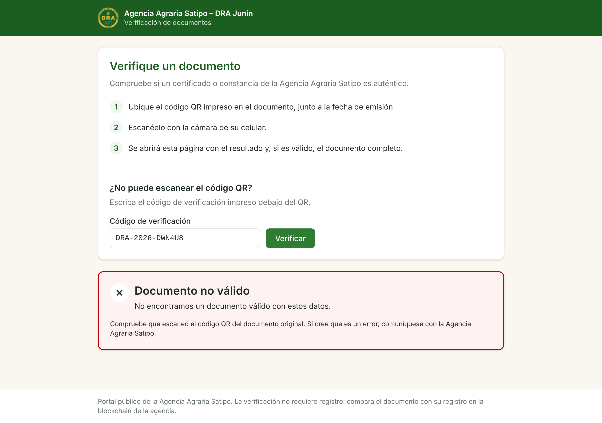
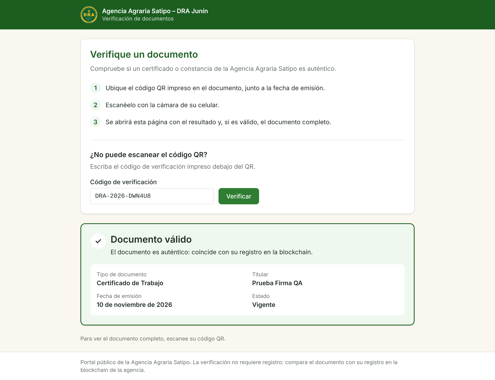
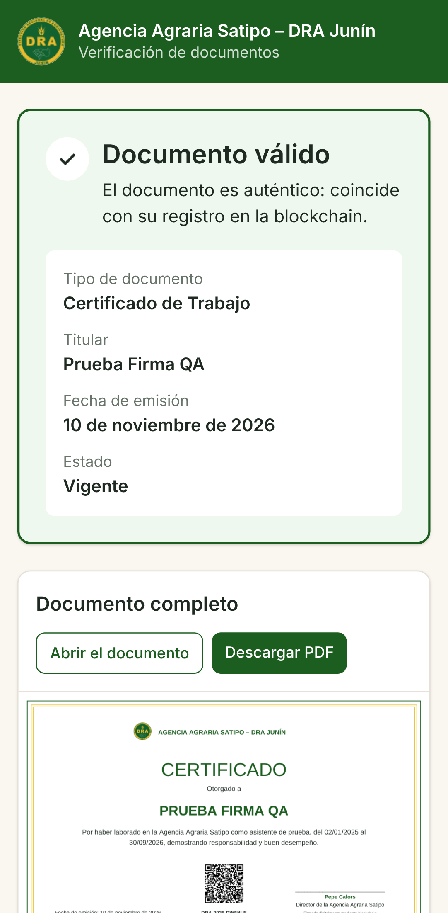

# DRA-66 · Respaldos y recuperación (apagados hasta PROD)

- **Sprint:** 8 · **Puntos:** 5 · **Fecha de la prueba en QA:** 13/11/2026
- **Documentación:** [respaldos.md](../../../arquitectura/respaldos.md)

## Qué se construyó

| Parte | Dónde |
|---|---|
| Copia diaria del disco completo (base de datos, PDF del IPFS y la blockchain) a las 03:00 de Lima, 30 copias, con Data Lifecycle Manager, detrás del interruptor `respaldos_activos` (apagado) | `infra/aws/modulos/ambiente/respaldos.tf` |
| Volcado de PostgreSQL a las 02:50 de Lima, 3 conservados | `infra/aws/servidor/volcar-base.sh`, `desplegar.sh` |
| Disparadores "QA – Respaldar ahora" y "QA – Restaurar respaldo"; opción "respaldos" en Encender; Destruir borra las copias | `.github/workflows/qa-*.yml`, `infra/aws/acciones/` |
| Permiso para que GitHub cree solo el rol de respaldos, solo con la política de copias y solo para ese servicio | `infra/aws/cuenta/cuenta.yml` |

## Prueba en QA

QA tenía un documento firmado (A, `DRA-2026-DWN4U8`) y las cuentas del PO. **No se cambiaron sus contraseñas** para firmar documentos nuevos. Por eso, en lugar de "firmar B después de la copia", se probó el desastre real: **perder la base de datos y el IPFS**.

| # | Paso | Resultado |
|---|---|---|
| 1 | Actualizar la pila `dra-satipo-cuenta` con el nuevo `cuenta.yml` | Solo cambia la política del usuario de GitHub, sin reemplazarlo. UPDATE_COMPLETE |
| 2 | QA – Encender con respaldos | Política de copias ENABLED, temporizador del volcado a las 07:50 UTC (02:50 de Lima), `RESPALDOS_ACTIVOS='si'` |
| 3 | Verificar A antes de la copia | VÁLIDO |
| 4 | QA – Respaldar ahora | **Falló** (ajuste 1). Tras corregirlo: volcado de 60 KB y copia `snap-0790ac46b34765d5a`, con etiquetas `Name`, `Ambiente=qa` y `TipoDeRespaldo=manual` |
| 5 | Simular la pérdida: borrar los volúmenes de PostgreSQL y del IPFS y volver a desplegar | A sale **"No encontramos un documento válido"** ([captura 1](dra66_01_portal_tras_la_perdida.png)) |
| 6 | QA – Restaurar respaldo con la copia y `RESTAURAR-QA` | Disco reemplazado y plataforma desplegada en **menos de 4 minutos** (04:36–04:40 UTC) |
| 7 | Verificar A por el código | **Documento válido** ([captura 2](dra66_02_portal_tras_restaurar.png)) |
| 8 | Verificar A por el QR, en el celular | **Documento válido**, con el PDF completo leído del IPFS restaurado ([captura 3](dra66_03_qr_con_pdf_tras_restaurar.png)) |
| 9 | Cuentas y blockchain | Volvieron las 5 cuentas. La cadena volvió atrás, del bloque 9119 al 8958 (el de la copia), y siguió produciendo bloques |
| 10 | QA – Encender sin respaldos | Política borrada, temporizador quitado, `RESPALDOS_ACTIVOS='no'`. Antes, un `terraform plan` local confirmó que el servidor solo se actualiza (etiquetas), sin reemplazarse |
| 11 | Limpieza | Copia de prueba y disco reemplazado borrados: no queda ninguna copia ni disco suelto de QA |

**Costo medido:** la copia completa ocupó **5,4 GB** de los 20 del disco, unos $0,27 al mes. Con las copias diarias incrementales, PROD costaría menos de $1 al mes.

## Pruebas automáticas (CI)

Cantidades tomadas del registro de la CI ([43365027715](https://github.com/Garyn14/TESIS_FERNANDO/actions/runs/43365027715)):

| Prueba | Antes | Ahora |
|---|---|---|
| Terraform (con y sin el interruptor, hora inválida, etiquetas de las copias) | 11 | 14 |
| Plantilla de la cuenta | 11 | 12 |
| Disparadores, con un `aws` simulado (respaldar, listar, restaurar) | 26 | 46 |
| Servidor en Docker (el volcado se genera, se rota y se restaura) | 16 | 19 |

## Ajustes encontrados en QA

1. **"Respaldar ahora" fallaba por una etiqueta repetida.** El disco ya trae `Ambiente` (las `default_tags` de Terraform). Copiar las etiquetas del disco y además agregar `Ambiente` hace que AWS rechace la copia. La política diaria tenía el mismo problema.
   - Ahora las copias llevan sus propias etiquetas y no copian las del disco.
   - Hay una prueba de Terraform y otra de los disparadores para esto.
2. **El error quedaba oculto.** El paso usaba `| tee` sin `pipefail`, así que falló el resumen y no el respaldo. Los disparadores de respaldos usan ahora `shell: bash`, que agrega `pipefail`.
3. **El disco restaurado llega sin etiquetas.** AWS no las copia al reemplazar el disco. Encender se las devuelve sin reemplazar el servidor (comprobado con `terraform plan`). Quedó anotado en `respaldos.md`.

## Decisiones para validar

- La blockchain también se respalda y se restaura junto con todo lo demás, porque hoy la red tiene un solo operador. Al restaurar, el Director restablece MetaMask.
- En PROD se puede perder hasta un día de trabajo (una copia diaria).
- Las copias manuales no las borra la retención: se borran a mano o con Destruir.
