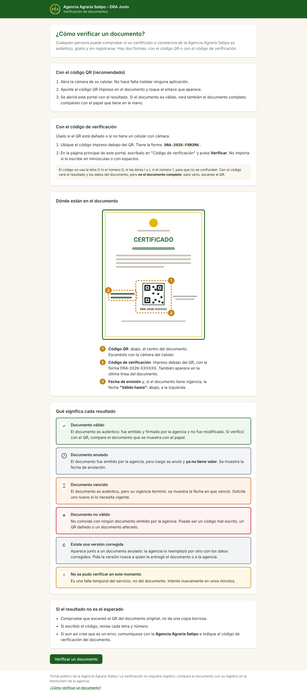
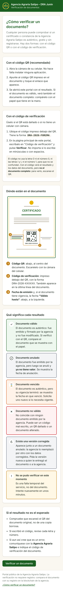

# DRA-70 · "¿Cómo verificar un documento?" en el portal

- **Sprint:** 8 · **Puntos:** 2 · **Épica:** E8 · Ayuda y documentación (DRA-69)
- **Historia refinada:** [E8_ayuda_documentacion.md](../../../requerimientos/historias/E8_ayuda_documentacion.md)

## Qué se construyó

Una página del portal, `/como-verificar`, con:
- cómo verificar con el código QR, sin instalar nada ni registrarse;
- cómo verificar con el código de verificación (con el código no se ve el documento completo);
- un **dibujo esquemático** del certificado que señala el QR, el código y las fechas, sin datos de nadie;
- qué significa cada uno de los **6 resultados**, con el mismo título, ícono y color que se ven al verificar (salen del mismo archivo, `resultados.ts`);
- qué hacer si el resultado no es el esperado.

Se llega desde la portada, desde el pie de todas las páginas y desde el resultado "Documento no válido". CloudFront ya sirve la ruta: no hubo cambios de infraestructura.

## Qué se comprueba (prueba de punta a punta del Sprint 8)

Portal y backend reales, en un entorno limpio (`./e2e/regresion.sh 8`): **5 pasos correctos** ([resultado.txt](resultado.txt)).

| Paso | Captura |
|---|---|
| Desde la portada, el enlace "¿Cómo verificar un documento?" abre la guía | [dra70_01](dra70_01_portada_con_enlace.png) |
| La guía tiene las 5 secciones, el dibujo y los 6 resultados en orden, sin términos técnicos | [dra70_02](dra70_02_guia_escritorio.png) |
| Un QR que no corresponde a ningún documento da "Documento no válido", con el enlace a la guía | [dra70_03](dra70_03_no_valido_con_enlace.png) |
| El pie lleva a la guía, y "Verificar un documento" vuelve a la portada con el campo del código | — |
| En el celular (Pixel 7) se lee sin desplazarse de lado | [dra70_04](dra70_04_guia_celular.png) |

**Regresión** en un entorno limpio ([regresion.txt](regresion.txt)): Sprint 5 (portal), 17 pasos correctos; Sprint 7 (vigencia en el portal), 26 pasos correctos.

## Pruebas automáticas

- Portal (Vitest): 7 pruebas nuevas en `ayuda/ComoVerificar.test.tsx` (ruta, contenido, dibujo, resultados, sin términos técnicos, enlaces) y una en `App.test.tsx` (el enlace desde "Documento no válido").
- Las cantidades de la CI están en `docs/arquitectura/integracion-continua.md`.

## Ajustes encontrados

1. **Dibujo:** la señal 2 tapaba el código de verificación. Se agrandó el recuadro y se movieron las señales. En el celular, el código se partía en dos líneas: ahora va en una sola.
2. **Prueba de punta a punta:** "Verificar un documento" también coincidía con "¿Cómo verificar un documento?". La prueba busca el botón por su nombre exacto.
3. **Formato:** la CI detectó un archivo sin el formato de Prettier.

## Para validar con el PO

- **Teléfono, correo o dirección de atención de la agencia:** la guía dice "comuníquese con la Agencia Agraria Satipo". Se agregan cuando el PO los entregue.
