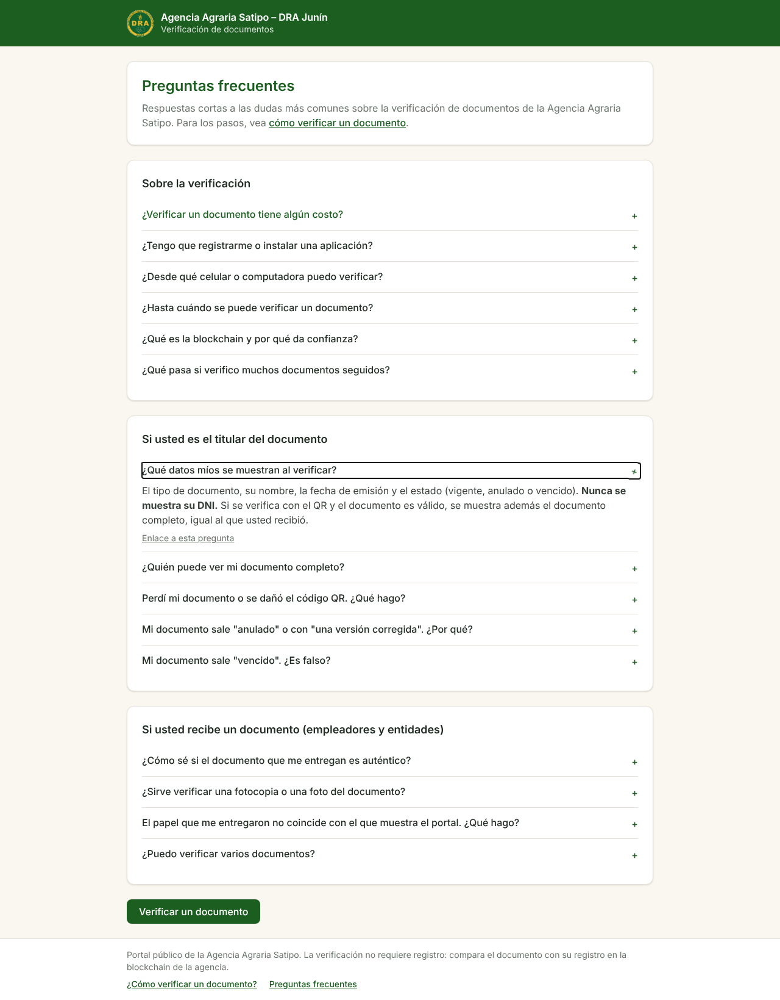

# DRA-71 · Preguntas frecuentes del portal

- **Sprint:** 8 · **Puntos:** 3 · **Épica:** E8 · Ayuda y documentación (DRA-69)
- **Historia refinada:** [E8_ayuda_documentacion.md](../../../requerimientos/historias/E8_ayuda_documentacion.md)

## Qué se construyó

La página `/preguntas-frecuentes` del portal, con **15 preguntas** en tres grupos:

| Grupo | Preguntas |
|---|---|
| Sobre la verificación | Costo, registro o aplicación, desde qué equipo, hasta cuándo, qué es la blockchain, muchas consultas seguidas (límite de 10 por minuto) |
| Si usted es el titular del documento | Qué datos se muestran (nunca el DNI), quién puede ver el documento completo, qué hacer si lo perdió, anulado o con versión corregida, vencido |
| Si usted recibe un documento | Cómo saber si es auténtico, fotocopias o fotos, si el papel no coincide, varios documentos |

- Cada pregunta se abre y se cierra (acordeón del navegador: funciona con el teclado y los lectores de pantalla).
- Cada pregunta tiene su propio enlace, por ejemplo `/preguntas-frecuentes#perdi-mi-documento`, que la abre directamente.
- Se llega desde la portada, desde el pie (junto a "¿Cómo verificar un documento?") y desde la guía de DRA-70.
- Las preguntas están en un archivo de datos (`portal/src/ayuda/preguntas.tsx`): el mismo formato servirá para DRA-73.

## Qué se comprueba (prueba de punta a punta del Sprint 8)

Portal y backend reales, en un entorno limpio (`./e2e/regresion.sh 8`): **9 pasos correctos**, 5 de DRA-70 y 4 de DRA-71 ([resultado.txt](resultado.txt)).

| Paso | Captura |
|---|---|
| Desde la portada se llega a las preguntas: tres grupos, todas cerradas | [dra71_01](dra71_01_preguntas_cerradas.png) |
| Una pregunta se abre y se cierra con un clic real, y se abre con el teclado (Enter) | [dra71_02](dra71_02_pregunta_abierta.png) |
| El enlace `#perdi-mi-documento` abre esa pregunta en el celular, sin desplazamiento lateral | [dra71_03](dra71_03_enlace_directo_celular.png) |
| Se llega también desde el pie y desde la guía de DRA-70 | — |

**Regresión** en un entorno limpio ([regresion.txt](regresion.txt)): Sprint 5 (portal), 17 pasos correctos.

## Pruebas automáticas

- Portal (Vitest): 8 pruebas nuevas en `ayuda/PreguntasFrecuentes.test.tsx`. Cubren la ruta, los grupos cerrados, el acordeón, el enlace directo, que los enlaces no se repiten, que las respuestas coinciden con el sistema (el DNI y el mensaje del límite) y que no hay términos técnicos ni faltan accesos.
- La CI pasó de 20 a 28 pruebas del portal ([43621453585](https://github.com/Garyn14/TESIS_FERNANDO/actions/runs/43621453585)).

## Ajustes encontrados

1. **jsdom no abre un `
` al pulsar su título:** la prueba unitaria comprueba la estructura, y el clic y el teclado reales se prueban en el navegador (e2e).
2. **La prueba del pie de DRA-70** buscaba "el" enlace del pie; ahora hay dos y lo busca por su nombre.

## Para validar con el PO

- Cómo se pide una copia nueva de un documento, su costo y su plazo. Por ahora la respuesta dice "acérquese a la Agencia Agraria Satipo".
- Los datos de atención de la agencia (pendiente desde DRA-70).
