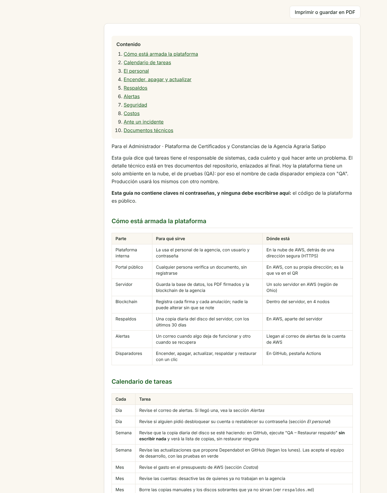

# DRA-74 · Guía de operación del Administrador

- **Sprint:** 8 · **Puntos:** 3 · **Épica:** E8 · Ayuda y documentación (DRA-69)
- **Historia refinada:** [E8_ayuda_documentacion.md](../../../requerimientos/historias/E8_ayuda_documentacion.md)
- **La guía:** [plataforma/frontend/src/ayuda/guia-de-operacion.md](../../../../plataforma/frontend/src/ayuda/guia-de-operacion.md)

## Qué se construyó

- Una **"Guía de operación"** en la plataforma, **solo para el Administrador**:
  - es una opción de su menú y un enlace en su recuadro "¿Necesita ayuda?";
  - los demás roles no la tienen, y si abren `#/operacion` ven "No tiene permiso para ver esta sección".
- **10 secciones:**
  1. cómo está armada la plataforma;
  2. el calendario de tareas (cada día, semana, mes y 90 días);
  3. el personal y el cambio de Director;
  4. encender, apagar y actualizar;
  5. respaldos;
  6. qué hacer con cada alerta;
  7. seguridad;
  8. costos;
  9. ante un incidente;
  10. enlaces a los documentos técnicos en GitHub.
- **Usa el mismo componente que el manual** (DRA-75), generalizado como `DocumentoDeAyuda`: Markdown, índice, un enlace por sección e impresión a PDF. Los enlaces externos se abren en otra pestaña.
- **El manual menciona la nueva opción** del Administrador.

## Qué se comprueba (prueba de punta a punta del Sprint 8)

En un entorno limpio: **17 pasos correctos**, 2 de DRA-74 ([resultado.txt](resultado.txt)).

| Paso | Resultado |
|---|---|
| El Administrador abre la guía desde su inicio | Índice con 10 secciones. El enlace a "Respaldos" la deja arriba de la pantalla. Los documentos técnicos apuntan a GitHub y se abren en otra pestaña ([captura](dra74_01_guia.png)) |
| Los demás roles no la ven | No está en el menú del Emisor de área, y al abrir `#/operacion` ve "No tiene permiso para ver esta sección" ([captura](dra74_02_sin_permiso.png)) |

**Regresión** ([regresion.txt](regresion.txt)): el menú del Administrador cambió, así que se corrieron los Sprints 1 y 7, que lo comprueban. Dieron 32 y 26 pasos correctos.

## Pruebas automáticas

- Frontend (Vitest): 7 pruebas nuevas en `ayuda/GuiaDeOperacion.test.tsx`:
  - solo está en el menú del Administrador y solo su inicio la enlaza;
  - el índice y las secciones;
  - los enlaces a GitHub, y que los documentos que nombra existen en `docs/arquitectura/`;
  - **que los disparadores se llaman igual que en `.github/workflows/`**;
  - **que la guía no tiene claves de AWS, billeteras, correos ni contraseñas**.
- La CI pasó de 205 a 212 pruebas del frontend ([43627117530](https://github.com/Garyn14/TESIS_FERNANDO/actions/runs/43627117530)).

## Ajustes encontrados

1. **La introducción decía "QA – …"** y la prueba de los nombres la tomó por un disparador. Se reescribió.
2. **La prueba de punta a punta saltaba a "Ante un incidente"**, que está al final de la guía y no puede subir hasta arriba de la pantalla. Ahora usa una sección del medio.

## Para validar con el PO

- Los contactos del equipo de soporte y de la DRA, para la sección "Ante un incidente".
- Los nombres de los disparadores de PROD (DRA-65).
