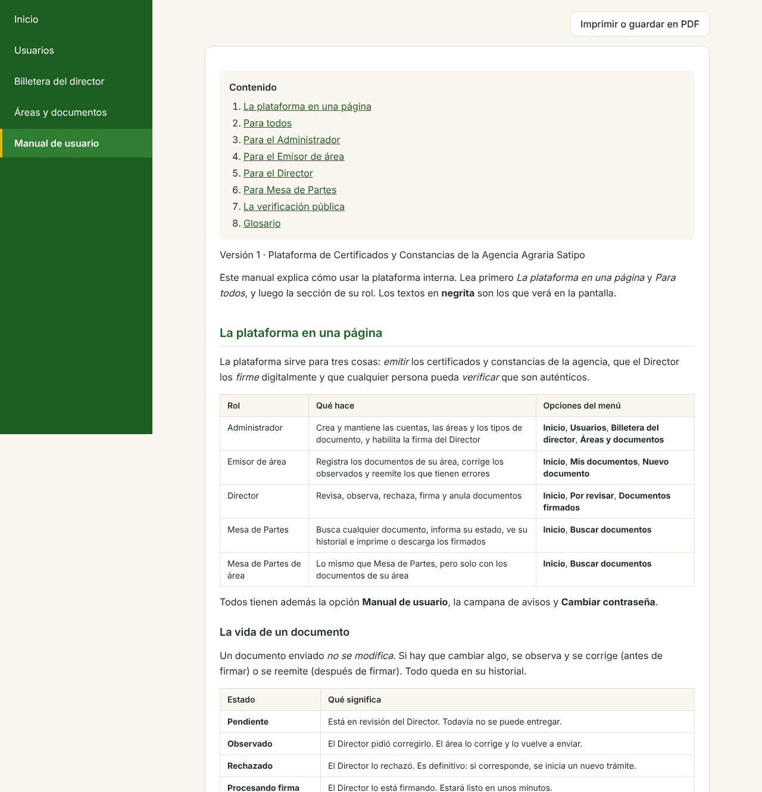

# DRA-75 · Manual de usuario general (versión 1)

- **Sprint:** 8 · **Puntos:** 3 · **Épica:** E8 · Ayuda y documentación (DRA-69)
- **Historia refinada:** [E8_ayuda_documentacion.md](../../../requerimientos/historias/E8_ayuda_documentacion.md)
- **El manual:** [plataforma/frontend/src/ayuda/manual.md](../../../../plataforma/frontend/src/ayuda/manual.md)

## Qué se construyó

- Un **manual de usuario** en la plataforma, el mismo para los 5 roles. Está escrito en Markdown en el repositorio y se puede leer también en GitHub. Tiene 8 secciones:
  1. la plataforma en una página y la vida de un documento;
  2. para todos;
  3. una sección por cada rol (4 en total);
  4. la verificación pública;
  5. el glosario.
- La opción **"Manual de usuario"** al final del menú de todos los roles.
- En el inicio, el recuadro **"¿Necesita ayuda?"**, con un enlace a la sección del rol de la persona (por ejemplo, `#/manual/para-el-emisor-de-area`) y otro al manual completo.
- Un índice con un enlace por sección y el botón **"Imprimir o guardar en PDF"**. Al imprimir no salen el menú ni el encabezado.
- **4 capturas** (inicio, registrar, revisar y firmar, buscar y entregar), con datos ficticios. Las genera la prueba de punta a punta: `E2E_ACTUALIZAR_MANUAL=1 ./e2e/regresion.sh 8`.
- Dependencias nuevas del frontend: `react-markdown` y `remark-gfm`.

## Qué se comprueba (prueba de punta a punta del Sprint 8)

En un entorno limpio, con la red Besu real: **15 pasos correctos**, de los cuales 6 son de DRA-75 ([resultado.txt](resultado.txt)).

| Paso | Resultado |
|---|---|
| Preparación: cuentas reales y la billetera del Director habilitada | Las cuentas se crean desde la pantalla Usuarios; se otorga el rol de firmante con transacciones reales |
| El inicio lleva a la sección del rol | Desde el inicio de Pedro (Emisor de área), "Ver lo que hace el rol Emisor de área" abre esa sección arriba de la pantalla. El Administrador también tiene la opción en su menú |
| Al imprimir sale solo el manual | Sin el menú, el encabezado ni el botón. El título del manual aparece solo al imprimir: [manual impreso (PDF, 8 páginas A4)](dra75_02_manual_impreso.pdf) |
| Capturas del manual | Registrar (Pedro), revisar y firmar con la billetera (Carlos) y buscar y entregar el documento firmado (Luz) |

## Pruebas automáticas

- Frontend (Vitest): 6 pruebas nuevas en `ayuda/Manual.test.tsx`:
  - el menú de todos los roles, el índice, la impresión y el enlace del inicio a la sección de cada rol;
  - **que el manual nombra las opciones del menú y los estados igual que la pantalla**;
  - **que todo lo que el manual pone en negrita existe en el código de las pantallas**.
- Las pruebas del menú de cada rol (HU03) ahora esperan "Manual de usuario".
- La CI pasó de 199 a 205 pruebas del frontend ([43623215214](https://github.com/Garyn14/TESIS_FERNANDO/actions/runs/43623215214)).

## Regresión

El menú de todos los roles cambió, así que se corrieron las pruebas de punta a punta de los Sprints 1 a 7, cada una en un entorno limpio. Ahora esperan la nueva opción del menú. Todas pasaron ([regresion.txt](regresion.txt)):

| Sprint | Pasos correctos |
|---|---|
| 1 | 32 |
| 2 | 23 |
| 3 | 34 |
| 4 | 32 |
| 5 | 17 |
| 6 | 30 |
| 7 | 26 |

## Ajustes encontrados

1. **Las capturas sin tamaño fijo** se cargaban después de llegar a la sección del rol y la empujaban hacia abajo, a 530 px del borde superior. Ahora tienen su tamaño (1280 × 800) y la sección queda arriba.
2. **Dos títulos "Manual de usuario"** (el del encabezado y el del manual). El del manual sale solo al imprimir, cuando el encabezado se oculta.
3. **Las capturas no se pueden copiar al frontend durante la prueba:** el servidor de desarrollo recarga la página. Se copian al terminar.
4. **En las capturas de registrar y firmar no se veían los botones:** la prueba los desplaza a la vista antes de capturar.
5. **Algunos nombres del documento de negocio no coinciden con la pantalla** (por ejemplo, "Enviar al Director" en lugar de "Enviar a revisión"). El manual usa los de la pantalla, y la prueba de las negritas lo garantiza.

## Para validar con el PO

- Si el manual debe mencionar los nombres reales de las áreas y de los documentos, que aún están por confirmar (ver `docs/negocio/flujos-del-sistema.md`, sección 7).
