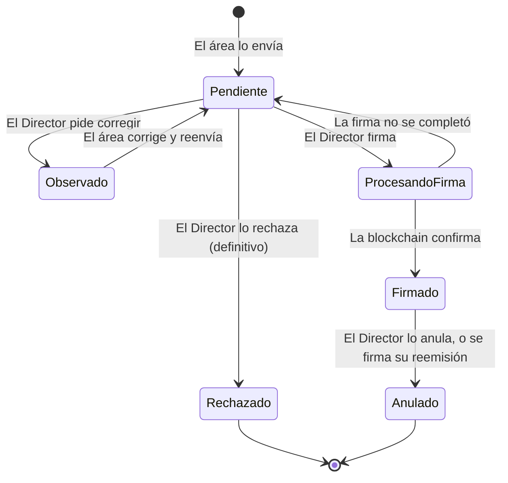

# Plataforma de Certificados y Constancias: flujos completos del sistema

Documento de apoyo para la reunión con el negocio de la Agencia Agraria Satipo (DRA Junín). Explica, en lenguaje claro, **qué hace la plataforma, quién hace qué y cómo fluye un documento** desde que se registra hasta que un tercero lo verifica con su celular.

Al final están las **preguntas que el negocio todavía debe responder** y las **preguntas que el negocio podría hacer**, con su respuesta.

---

## Contenido

1. [La plataforma en una página](#1-la-plataforma-en-una-página)
2. [Quiénes usan la plataforma](#2-quiénes-usan-la-plataforma)
3. [La vida de un documento](#3-la-vida-de-un-documento)
4. [Los flujos, paso a paso](#4-los-flujos-paso-a-paso)
   - [F1. Preparar la plataforma (Administrador)](#f1-preparar-la-plataforma-administrador)
   - [F2. Ingresar a la plataforma (todos)](#f2-ingresar-a-la-plataforma-todos)
   - [F3. Registrar un documento a solicitud de parte (Área encargada)](#f3-registrar-un-documento-a-solicitud-de-parte-área-encargada)
   - [F4. Emitir certificados por lista (Área encargada)](#f4-emitir-certificados-por-lista-área-encargada)
   - [F5. Revisar, observar, rechazar y firmar (Director)](#f5-revisar-observar-rechazar-y-firmar-director)
   - [F6. Corregir un documento observado (Área encargada)](#f6-corregir-un-documento-observado-área-encargada)
   - [F7. Qué pasa por dentro al firmar](#f7-qué-pasa-por-dentro-al-firmar)
   - [F8. Verificar un documento (cualquier persona)](#f8-verificar-un-documento-cualquier-persona)
   - [F9. Atender al ciudadano (Mesa de Partes)](#f9-atender-al-ciudadano-mesa-de-partes)
   - [F10. Avisos dentro de la plataforma](#f10-avisos-dentro-de-la-plataforma)
   - [F11. Anular un documento firmado (Director)](#f11-anular-un-documento-firmado-director)
   - [F12. Reemitir un documento con datos corregidos (Área encargada y Director)](#f12-reemitir-un-documento-con-datos-corregidos-área-encargada-y-director)
5. [Reglas de control interno y seguridad](#5-reglas-de-control-interno-y-seguridad)
6. [Lo que la plataforma no hace (todavía)](#6-lo-que-la-plataforma-no-hace-todavía)
7. [Preguntas pendientes para el negocio](#7-preguntas-pendientes-para-el-negocio)
8. [Preguntas que puede hacer el negocio](#8-preguntas-que-puede-hacer-el-negocio)
9. [Glosario](#9-glosario)
10. [Para la reunión: agenda sugerida y ambiente de QA](#10-para-la-reunión-agenda-sugerida-y-ambiente-de-qa)

---

## 1. La plataforma en una página

**El problema de hoy**, contado con las tres personas del video de presentación:

| Persona | Hoy | Con la plataforma |
|---|---|---|
| **Rosa**, del Área de Capacitación | Termina un taller con 40 agricultores y hace 40 certificados uno por uno. | Carga la lista una sola vez. La plataforma revisa los datos y prepara los 40 certificados. |
| **Ing. Carlos**, Director de la agencia | Cada certificado necesita su firma, pero sale en comisión de campo y los documentos esperan días sobre su escritorio. | Revisa y firma desde la plataforma, con su billetera digital, esté donde esté. Cada firma queda registrada en la blockchain de la agencia. |
| **Lucía**, que postula a un trabajo | Quien la contrata no tiene cómo saber si su certificado es auténtico, salvo llamar a la agencia y esperar. | Quien recibe el certificado escanea el QR y en segundos sabe si es auténtico, sin llamar a nadie. |

**Las tres cosas que hace la plataforma:** emitir, firmar y verificar, con un registro que nadie puede alterar sin que se note.

**Las dos aplicaciones:**

| Aplicación | Quién la usa | Acceso |
|---|---|---|
| **Plataforma interna** | El personal de la agencia | Con usuario y contraseña; cada rol ve solo lo suyo |
| **Portal público de verificación** | Cualquier persona: empleadores, municipalidades, bancos, el propio ciudadano | Sin registro; se abre al escanear el QR o escribiendo el código |

**Los documentos que emite hoy** (los nombres están pendientes de validar, ver la [sección 7](#7-preguntas-pendientes-para-el-negocio)):

| Área | Tipos de documento | Cómo se originan |
|---|---|---|
| Área de Capacitación | Certificado de Capacitación, Certificado de Reconocimiento | **De oficio**: por lista, un certificado por beneficiario |
| Área de Desarrollo Agrario | Constancia de Productor Activo | **A solicitud de parte**: uno por solicitud, con expediente |
| Área de Administración | Certificado de Prácticas, Certificado de Trabajo | **A solicitud de parte** |

---

## 2. Quiénes usan la plataforma

| Rol | Quién es en la agencia | Qué puede hacer | Menú que ve |
|---|---|---|---|
| **Administrador** | Responsable de sistemas | Crea, edita, desactiva y reactiva cuentas; restablece contraseñas; registra la billetera del Director y le otorga o revoca el permiso de firmar | Inicio, Usuarios, Billetera del director |
| **Área encargada** | Personal de cada área (Capacitación, Desarrollo Agrario, Administración) | Registra documentos de **su área**, emite por lista, corrige los observados y reemite los firmados con error | Inicio, Mis documentos, Nuevo documento |
| **Director** | El director de la agencia | Revisa, observa, rechaza, firma y anula documentos | Inicio, Por revisar, Documentos firmados |
| **Consulta interna** | Mesa de Partes | Busca cualquier documento, informa su estado al ciudadano, ve su historial e imprime o descarga los firmados (incluidos duplicados) | Inicio, Buscar documentos |
| **Público** | Cualquier tercero | Verifica la autenticidad de un documento | Portal público, sin menú |

Todos los roles internos tienen la **campana de avisos** en el encabezado y la opción **Cambiar contraseña**.

---

## 3. La vida de un documento

| Estado | Qué significa (así lo explica la plataforma a Mesa de Partes) |
|---|---|
| **Pendiente** | Está en revisión del Director. Todavía no se puede entregar. |
| **Observado** | El Director pidió corregir el documento. El área lo corregirá y lo volverá a enviar. |
| **Rechazado** | El Director rechazó el documento. Es definitivo: si corresponde, el ciudadano debe iniciar un nuevo trámite. |
| **Procesando firma** | El Director está firmando el documento. Estará listo en unos minutos. |
| **Firmado** | Firmado y registrado en la blockchain. Se puede entregar al ciudadano. |
| **Anulado** | Fue anulado y ya no es válido. |

**Una regla de oro:** un documento enviado **no se modifica**. Si hay que cambiar algo, se observa y se corrige (antes de firmar) o se reemite (después de firmar). Todo queda en su historial.

---

## 4. Los flujos, paso a paso

### F1. Preparar la plataforma (Administrador)

**Para qué:** dejar listas las cuentas del personal y habilitar la firma del Director. Se hace una vez y luego solo cuando cambia el personal.

| Paso | Qué hace | Qué controla la plataforma |
|---|---|---|
| 1 | Entra con la cuenta `admin`, que se crea al instalar la plataforma, y cambia su contraseña temporal. | Nadie usa la plataforma con una contraseña que otro conoce. |
| 2 | En **Usuarios**, crea cada cuenta: nombre de usuario, nombre completo, rol, contraseña temporal y, si es del Área encargada, **su área**. | El usuario no se repite; cada cuenta tiene un solo rol; el área es obligatoria para el Área encargada. |
| 3 | Entrega a cada persona su usuario y su contraseña temporal. | Al primer ingreso, la persona debe cambiarla. |
| 4 | En **Billetera del director**, registra la dirección de la billetera digital del Director. | Valida el formato y que no esté asignada a otra cuenta. |
| 5 | Conecta **su propia** billetera (la de administrador del contrato) y pulsa **Otorgar rol de firmante**. Confirma en la billetera. | La fila del Director pasa a "✓ Firmante activo". Ese estado se lee de la blockchain, no de la base de datos. |

**Mantenimiento del personal:**

- **Editar:** se cambia el nombre, el rol o el área. El nombre de usuario no cambia, porque identifica a la persona en el historial.
- **Desactivar:** la cuenta no se borra nunca. Pierde el acceso al instante, aunque tenga la sesión abierta, y su historial se conserva. Se puede reactivar.
- **Restablecer la contraseña:** si alguien la olvida o se bloqueó, el Administrador le asigna una nueva contraseña temporal. Eso también desbloquea la cuenta.
- **Cambio de Director:** el Administrador revoca el permiso de firmar a la billetera anterior y lo otorga a la nueva. **Los documentos firmados antes siguen siendo válidos.**

Protecciones: el Administrador no puede desactivarse ni quitarse el rol a sí mismo, y siempre queda al menos un Administrador activo.

### F2. Ingresar a la plataforma (todos)

| Situación | Qué pasa |
|---|---|
| Usuario o contraseña incorrectos | "Usuario o contraseña incorrectos". No se revela cuál de los dos falló. |
| **3 intentos fallidos seguidos** | La cuenta se bloquea **una hora** y se muestra hasta qué hora. El Administrador puede desbloquearla antes restableciendo la contraseña. |
| Contraseña temporal | Solo se ve la pantalla "Cambie su contraseña" hasta cambiarla (de 8 a 20 caracteres). |
| **30 minutos sin actividad** | La sesión expira: "Su sesión expiró por inactividad". |
| Cuenta desactivada | Se indica que está desactivada y que se comunique con el Administrador. |
| Intenta abrir una pantalla de otro rol | "No tiene permiso para ver esta sección". |

### F3. Registrar un documento a solicitud de parte (Área encargada)

**Ejemplo:** Pedro, del Área de Administración, emite el Certificado de Trabajo que Lucía pidió en Mesa de Partes.

| Paso | Qué hace | Qué controla la plataforma |
|---|---|---|
| 1 | **Nuevo documento** → elige el tipo. Solo ve los tipos de su área. | Un área no puede emitir documentos de otra. |
| 2 | Completa el formulario: **número de expediente** de Mesa de Partes, nombres y apellidos, **DNI** y los datos propios del tipo (cargo y fechas, cultivo y sector, modalidad de prácticas…). | Expediente con formato válido y que no se repite; DNI de 8 dígitos; la fecha de fin no es anterior a la de inicio ni posterior a hoy. |
| 3 | Pulsa **Vista previa**: ve el documento como quedará, con la marca "VISTA PREVIA". | |
| 4 | Pulsa **Enviar al Director**. | El documento queda **Pendiente**, recibe su **código de verificación** (por ejemplo `DRA-2026-F8R2MA`) y ya no se puede modificar. |

Lo sigue en **Mis documentos**, que muestra solo los documentos de su área.

### F4. Emitir certificados por lista (Área encargada)

**Ejemplo:** Rosa, del Área de Capacitación, emite los certificados de los 40 participantes del taller de café.

| Paso | Qué hace | Qué controla la plataforma |
|---|---|---|
| 1 | **Nuevo documento** → Certificado de Capacitación (o de Reconocimiento). | |
| 2 | Escribe **una sola vez** los datos del evento: taller, fechas, horas, lugar y área organizadora. | |
| 3 | Agrega la relación de beneficiarios (nombres, apellidos y DNI): a mano o **descargando la plantilla Excel**, llenándola y subiéndola. | Revisa **cada fila**, marca los errores (DNI inválido, DNI repetido, nombre vacío) y no deja enviar hasta corregirlos. Admite de 1 a 300 beneficiarios. |
| 4 | Ve un **certificado de ejemplo** con la relación completa. | |
| 5 | Pulsa **Enviar**. | Se crea **un documento por beneficiario**, agrupados en un **lote** (por ejemplo, Lote 2026-001). Todos quedan Pendientes, cada uno con su propio código y su QR. |

### F5. Revisar, observar, rechazar y firmar (Director)

**Por revisar** muestra todo lo que enviaron las áreas, **del más antiguo al más reciente**. Cada lote aparece como un solo elemento. Las etiquetas "Corregido" y "Reemisión" indican los casos especiales.

**Revisar:** al abrir un documento, o un lote, la plataforma registra que el Director lo revisó. **No se puede firmar lo que no se abrió.**

**Las cuatro decisiones:**

| Decisión | Cuándo | Qué pasa |
|---|---|---|
| **Firmar** | El documento está correcto. | Se firma con la billetera (ver los pasos abajo). |
| **Observar** | Hay algo que corregir. | Motivo obligatorio (hasta 500 caracteres). Vuelve al área, que lo corrige y reenvía (F6). |
| **Rechazar** | No debe emitirse. | Motivo obligatorio y aviso: "El rechazo es definitivo. El documento no podrá reenviarse." |
| **Anular** | Ya está firmado y no debió emitirse. | Ver F11. |

**En un lote**, el Director puede observar o rechazar **algunos beneficiarios** o el lote completo, y firmar el resto. Por ejemplo, si observa 1 de 8 certificados y firma el lote, se firman 7 y el observado vuelve al área.

**Firmar varios a la vez:** en Por revisar, selecciona los documentos y lotes ya revisados y pulsa **Firmar seleccionados**. La ventana de firma muestra:

1. **Verificando su billetera:** que sea la registrada del Director, que esté en la red de la agencia y que tenga el permiso de firmar.
2. **Confirmación:** "Firmar N documentos · Costo de la operación: Sin costo". La billetera pide su propia confirmación.
3. **Preparando los documentos:** se genera el PDF final de cada uno (ver F7).
4. **Registrando la firma** en la blockchain, en grupos de hasta 50 documentos.
5. **Confirmando el registro.**
6. **Resultado:** "¡Listo! Se firmaron N documentos". Si alguno no se pudo firmar, se indica cuál y por qué.

En **Documentos firmados**, el Director ve lo que ya firmó y desde ahí puede anular.

### F6. Corregir un documento observado (Área encargada)

| Paso | Qué hace | Qué controla la plataforma |
|---|---|---|
| 1 | En **Mis documentos** ve el documento **Observado** y el **motivo** del Director (también le llega un aviso). | |
| 2 | Abre **Corregir y reenviar**: el formulario viene precargado con lo que envió. | En un certificado de lote solo se corrigen nombres, apellidos y DNI; los datos del evento son comunes a todo el lote. |
| 3 | Corrige y reenvía. | **Conserva su código** y su historial. Vuelve a Pendiente con la etiqueta **"Corregido"**, y el Director debe abrirlo de nuevo antes de firmarlo, para que vea lo que cambió. |

### F7. Qué pasa por dentro al firmar

Esto ocurre solo, en segundos, mientras el Director ve la ventana de firma:

| Paso | Qué ocurre | Para qué sirve |
|---|---|---|
| 1 | Se genera el **PDF final**: encabezado y logo de la agencia, nombre del beneficiario, texto, **fecha de emisión**, nombre del Director con "Firmado digitalmente mediante blockchain", **código QR** y **código de verificación**. | Es el documento oficial que se imprime y se entrega. **No imprime el DNI.** |
| 2 | Se calcula la **huella digital (hash)** del PDF. | Si alguien cambia una sola letra del PDF, la huella cambia. |
| 3 | El PDF se guarda en el **almacén privado de archivos (IPFS)** de la agencia. | Conserva el original para verificarlo y reimprimirlo. No es público. |
| 4 | La billetera del Director registra en la **blockchain** el código, la huella del PDF y una versión cifrada del DNI. | Queda la prueba de qué se firmó, quién lo firmó y cuándo, imposible de alterar sin que se note. |
| 5 | El servidor lee la blockchain y recién entonces marca el documento como **Firmado**. | **La blockchain manda:** nada se da por firmado si no está registrado ahí. |

**¿Y si se cierra el navegador a mitad de la firma?** Un proceso automático revisa la blockchain cada 30 segundos:

- si la firma quedó registrada, pasa el documento a Firmado;
- si pasan 15 minutos y no se registró, lo devuelve a Pendiente (ya revisado) para firmarlo de nuevo.

Ninguna firma se pierde ni queda a medias.

### F8. Verificar un documento (cualquier persona)

**Con el QR (lo normal):**

1. Quien recibe el documento escanea el QR con la cámara del celular. **No necesita ninguna aplicación ni registrarse.**
2. Se abre el portal: "Verificando el documento…".
3. En menos de dos segundos ve el resultado.

**Con el código de verificación**, cuando el QR no se puede escanear (una fotocopia borrosa o un código dictado por teléfono): en la portada del portal, escribe el código. Acepta minúsculas, espacios o sin guiones.

**Cómo decide el resultado:** la plataforma busca el documento, recupera su PDF del almacén privado, **recalcula su huella** y la compara con la registrada en la blockchain, y comprueba que el beneficiario no se haya cambiado. Si todo coincide, es válido.

| Resultado | Qué ve con el QR | Qué ve con el código |
|---|---|---|
| **Documento válido** | Tipo, titular, fecha de emisión, estado "Vigente" y **el documento completo**, que puede abrir o descargar | Lo mismo, **sin el documento**: "Para ver el documento completo, escanee su código QR." |
| **Documento anulado** | "Este documento fue anulado y ya no es válido", con la **fecha de anulación**. **No muestra el documento.** Si hubo reemisión: "Existe una versión corregida de este documento. Solicítela a la Agencia Agraria Satipo." | Igual |
| **Documento no válido** | "No encontramos un documento válido con estos datos", sin ningún dato | Igual |
| **Falla técnica** | "No se pudo verificar el documento en este momento. Intente nuevamente en unos minutos." **Nunca** dice "No válido" por una falla. | Igual |

**Protecciones del portal:**

- No muestra el DNI.
- Un resultado "No válido" no da pistas a quien intenta falsificar.
- Admite **10 consultas por minuto por persona**, para que nadie pueda probar códigos al azar.

### F9. Atender al ciudadano (Mesa de Partes)

| Paso | Qué hace | Qué ve |
|---|---|---|
| 1 | **Buscar documentos**: escribe un nombre, un DNI, un código, un número de expediente o un número de lote. Busca sin importar tildes ni mayúsculas, en **todas las áreas y en cualquier estado**. | Los resultados se actualizan mientras escribe. Filtros: Todos, En trámite, Firmados, Listos para entregar, Anulados y Rechazados. |
| 2 | Abre la **ficha** del documento. | El estado con su explicación en lenguaje claro (la tabla de la [sección 3](#3-la-vida-de-un-documento)), sus fechas, sus datos y el motivo si fue observado, rechazado o anulado. |
| 3 | Revisa el **Historial**. | Cada paso del trámite con fecha, hora y responsable: registro, revisión, observaciones, firma, impresiones… |
| 4 | Si lo necesita, abre el **Detalle técnico de auditoría** (plegado). | La huella del PDF, el identificador en el almacén, la transacción y el bloque de la firma, la billetera firmante y la dirección del contrato. Sirve para demostrar la trazabilidad ante un auditor. |
| 5 | Pulsa **Ver documento**, **Descargar PDF** o **Imprimir**. | **Antes de entregar, la plataforma verifica el documento con la blockchain**, igual que el portal. Si no coincide o está anulado, no lo entrega. |

**Duplicados:** si el ciudadano pierde su documento, se vuelve a imprimir **el mismo PDF**, con el mismo código y el mismo QR, sin reiniciar el trámite ni volver a firmarlo. Desde la segunda impresión, el historial la marca como **duplicado**. Las descargas también se registran.

### F10. Avisos dentro de la plataforma

Una **campana** en el encabezado muestra la cantidad de avisos sin leer. Al pulsar un aviso, se abre el documento o el lote correspondiente.

| Quién recibe | Cuándo | Ejemplo |
|---|---|---|
| **Director** | Llega un documento, un lote, un corregido o una reemisión para revisar | "Nuevo lote pendiente: Lote 2026-001 – Manejo integrado de plagas en café (3 certificados)" |
| **Área encargada** (toda el área) | Un documento suyo se firma, se observa, se rechaza o se anula | "Observado: Certificado de Trabajo – Lucía Paredes Quinto. Motivo: …" |
| **Mesa de Partes** | Un documento está listo para entregar o fue rechazado | "Listo para entregar: Certificado de Trabajo – Lucía Paredes Quinto (expediente EXP-2026-005391)" |

**Reglas de los avisos:**

- Un lote genera **un solo aviso**, con la cantidad de certificados.
- Cada persona marca sus avisos como leídos por su cuenta.
- Los avisos son internos: **no se envían por correo ni por SMS**.

### F11. Anular un documento firmado (Director)

**Cuándo:** un documento firmado no debió emitirse.

| Paso | Qué ocurre |
|---|---|
| 1 | En **Documentos firmados**, el Director pulsa **Anular** junto al documento (en un lote, junto a cada certificado). |
| 2 | Escribe el **motivo**, que es obligatorio, y ve el aviso: "La anulación es definitiva. El documento dejará de ser válido cuando se verifique su autenticidad." |
| 3 | Confirma con su billetera: "Anular 1 documento", sin costo. |
| 4 | La anulación queda registrada en la blockchain. **El registro original no se borra**: queda como anulado. |
| 5 | Desde ese momento, el portal lo muestra **Anulado** con la fecha, y Mesa de Partes ya no puede imprimirlo. El área recibe un aviso. |

El motivo de la anulación queda en el historial interno, **no en la blockchain**, porque puede contener datos personales.

### F12. Reemitir un documento con datos corregidos (Área encargada y Director)

**Cuándo:** un documento firmado tiene un error, por ejemplo un apellido mal escrito o una fecha equivocada, y hay que corregirlo **sin que el ciudadano vuelva a Mesa de Partes**.

| Paso | Quién | Qué ocurre |
|---|---|---|
| 1 | Área encargada | En el detalle del documento firmado pulsa **Reemitir con corrección**. El formulario viene precargado, con el aviso "Cuando el Director firme el nuevo documento, el original se anulará automáticamente". |
| 2 | Área encargada | Corrige al menos un dato y escribe el **motivo de la reemisión**. |
| 3 | — | Se crea un **documento nuevo**, con **otro código** y el **mismo número de expediente**. El original sigue Firmado y muestra "Reemisión en revisión". |
| 4 | Director | En Por revisar ve la etiqueta **"Reemisión"**, el código que reemplaza, **la lista de cambios** y el motivo. Puede firmarla, observarla o rechazarla. |
| 5 | Director | Al firmarla, **en una sola operación** se registra el nuevo documento y se anula el original, que queda con el aviso "Reemplazado por [código nuevo]". |

Si la reemisión se rechaza, el original sigue Firmado y se puede volver a reemitir.

En el portal, el original aparece **Anulado** con el aviso de que existe una versión corregida, **sin revelar su código**. Mesa de Partes sí ve el código nuevo, para entregarlo.

---

## 5. Reglas de control interno y seguridad

| Regla | Cómo se cumple |
|---|---|
| **Cada área ve solo lo suyo** | El Área encargada solo ve y registra documentos de su área, aunque intente entrar por otra vía. |
| **Quien administra los permisos no firma** | La billetera del Administrador del contrato no puede ser firmante. |
| **No se firma sin revisar** | El Director tiene que abrir el documento antes de poder firmarlo. Un corregido exige abrirlo de nuevo. |
| **Lo enviado no se modifica** | Solo se corrige con una observación (antes de firmar) o con una reemisión (después). |
| **Nada se borra** | Las cuentas se desactivan, los documentos se anulan y el historial no se modifica ni se elimina. |
| **La blockchain manda** | Un documento solo es Firmado o Anulado si la blockchain lo confirma. Si la base de datos y la blockchain no coinciden, gana la blockchain. |
| **El servidor nunca firma** | La firma la hace la billetera del Director en su navegador. La plataforma nunca guarda su clave privada. |
| **Datos personales protegidos** | El DNI no va en el PDF ni en el portal. En la blockchain solo hay una versión cifrada (HMAC). Los PDF están en un almacén **privado**, no en internet. |
| **Contraseñas** | Se guardan cifradas, nunca en claro. 3 intentos fallidos bloquean la cuenta una hora; la sesión expira a los 30 minutos sin actividad. |
| **Portal protegido** | Hasta 10 consultas por minuto por persona; los códigos excluyen caracteres que se confunden (O y 0, I y 1); el QR lleva un identificador aleatorio que no se puede adivinar. |
| **Firma sin costo** | La blockchain es privada de la agencia: firmar y anular no cuestan nada por operación. |

---

## 6. Lo que la plataforma no hace (todavía)

Conviene decirlo en la reunión para alinear expectativas:

- **No recibe solicitudes del ciudadano en línea.** El trámite sigue empezando en Mesa de Partes, que asigna el expediente.
- **No envía correos ni SMS.** Los avisos son internos, dentro de la plataforma.
- **No recupera contraseñas por correo.** Las restablece el Administrador.
- **No corrige los datos del evento de un lote ya firmado** (taller, fechas, lugar), porque son comunes a todos sus certificados. Requeriría una historia nueva.
- **No imprime un lote completo de una vez:** se imprime certificado por certificado (ver la pregunta 11 de la sección 7).
- **No tiene todavía un dominio propio ni un ambiente de producción.** Hoy funciona en el ambiente de QA, con direcciones `cloudfront.net`.
- **Las áreas y los tipos de documento no se crean desde una pantalla:** los agrega el equipo de desarrollo.

---

## 7. Preguntas pendientes para el negocio

Son decisiones del negocio. Mientras no se respondan, la plataforma funciona con una opción provisional. **Las de prioridad alta conviene cerrarlas antes de emitir documentos reales**, porque sus textos quedan impresos en cada PDF y registrados en la blockchain.

| # | Prioridad | Pregunta | Cómo funciona hoy |
|---|---|---|---|
| 1 | **Alta** | ¿Con qué **dominio** se publicará el portal (por ejemplo, `verifica.agrojunin.gob.pe`)? | Dirección provisional de QA. **El dominio va impreso en cada PDF y en su QR.** |
| 2 | **Alta** | ¿Cuál es el **formato del número de expediente** de Mesa de Partes? | `EXP-AAAA-NNNNNN` (por ejemplo, EXP-2026-004817), tomado del prototipo. |
| 3 | **Alta** | ¿Qué **campos y qué texto** lleva cada documento a solicitud de parte? | Los del prototipo. Se pidieron ejemplos reales de cada documento. |
| 4 | **Alta** | ¿Qué **columnas** tiene la lista de beneficiarios que arma hoy el área? | Nombres, Apellidos y DNI. Se pidió una lista real. |
| 5 | **Alta** | ¿Cuáles son los **nombres oficiales de las áreas** y de los tipos de documento? | Los del prototipo. |
| 6 | **Alta** | ¿Cuál es el **nombre oficial** que debe verse en pantalla y en los documentos? | "Agencia Agraria Satipo – DRA Junín". |
| 7 | **Alta** | ¿Quién **custodia la billetera de respaldo** del contrato (la que permite recuperar el control si se pierde la del Administrador)? | Pendiente. El procedimiento está documentado; la custodia física es de la institución. |
| 8 | Media | ¿Están bien los **campos y el texto del Certificado de Reconocimiento**? | Una propuesta del equipo: motivo, evento, fecha, lugar y área organizadora. |
| 9 | Media | ¿Las **descripciones** de cada tipo en "Nuevo documento" son las correctas? | Redactadas por el equipo. |
| 10 | Media | ¿Se debe **registrar quién busca o consulta** cada documento? | No se registra. Sí se registran las impresiones y descargas. |
| 11 | Media | ¿Hace falta **"Imprimir lote"** para imprimir todos los certificados de un lote de una vez? | Se imprime certificado por certificado. |
| 12 | Media | ¿Hay que **avisar a Mesa de Partes cuando se anula** un documento? | Se avisa solo al área. |
| 13 | Baja | ¿Hacen falta los indicadores **"Impresos esta semana"** y **"Duplicados emitidos"** del prototipo? | No se muestran. |
| 14 | Baja | ¿Hay que **borrar los avisos antiguos** o conservarlos por un tiempo? | Se conservan todos; el panel muestra los 30 más recientes. |
| 15 | Baja | Si alguien **cambia de área**, ¿debe seguir recibiendo los avisos de lo que envió antes? | Se avisa a quienes están en el área en el momento del resultado. |

**Además, decisiones que ya están construidas y conviene que el negocio confirme:**

- La **fecha de emisión impresa** es la del día de la firma; la oficial es la del registro en la blockchain, y coinciden en el día.
- El certificado **no imprime el DNI**.
- En lugar de una firma manuscrita, el documento dice **"Firmado digitalmente mediante blockchain"**.
- Mesa de Partes ve el **motivo** de una observación, de un rechazo o de una anulación, para explicárselo al ciudadano.
- Un lote admite **de 1 a 300 beneficiarios**, con número correlativo por año (Lote 2026-001).

Cada respuesta que cambie algo se registra como un **ticket nuevo** en Jira y se construye con el flujo de siempre.

---

## 8. Preguntas que puede hacer el negocio

**¿Se puede falsificar un certificado?**
Se puede imprimir algo parecido, pero no pasa la verificación. Al escanear el QR, la plataforma compara la huella del documento guardado con la registrada en la blockchain. Si alguien cambia un nombre, una fecha o una letra, la huella no coincide. Un documento inventado no está registrado y aparece como "No válido".

**¿Qué es la blockchain y por qué no basta una base de datos?**
Es un registro compartido entre varios servidores (la agencia tiene 4), donde lo escrito no se puede borrar ni modificar sin que se note. Una base de datos la puede cambiar quien tenga acceso. En la blockchain queda la prueba de qué se firmó, quién lo firmó y cuándo, aunque alguien manipule la base de datos.

**¿Cuánto cuesta cada firma?**
Nada por operación: la blockchain es privada de la agencia, no es una criptomoneda pública. El costo es solo el del servidor, que en QA está estimado en unos 11 a 14 dólares al mes encendido 10 horas diarias, y 2 a 3 dólares al mes apagado.

**¿Qué pasa si el Director pierde su celular o su billetera?**
El Administrador le revoca el permiso de firmar a esa billetera y se lo otorga a una nueva. Los documentos que firmó antes **siguen siendo válidos**.

**¿Qué pasa si cambia el Director?**
Lo mismo: se registra la billetera del nuevo Director y se le otorga el permiso. Los documentos del anterior siguen válidos y muestran quién los firmó.

**¿Se exponen los datos personales?**
- El portal no muestra el DNI.
- La blockchain solo guarda una versión cifrada del DNI, que no se puede revertir.
- Los PDF están en un almacén privado, no en internet.
- Solo quien tiene el QR puede ver el documento completo; con el código se ven solo los datos básicos.

**¿Qué pasa si se cae la blockchain o el almacén cuando alguien verifica?**
El portal dice "No se pudo verificar en este momento. Intente nuevamente en unos minutos". **Nunca** dice "No válido" por una falla técnica.

**¿Qué pasa si el Director cierra el navegador mientras firma?**
Nada se pierde. Un proceso automático revisa la blockchain cada 30 segundos y completa la firma, o devuelve el documento a Pendiente si no se registró.

**¿El ciudadano necesita instalar algo para verificar?**
No. Basta la cámara del celular. Quien verifica tampoco necesita registrarse.

**¿Y si el QR está borroso o es una fotocopia?**
Se escribe el código de verificación impreso debajo del QR (por ejemplo, `DRA-2026-F8R2MA`) en la portada del portal.

**¿Un error en un certificado firmado obliga a empezar de nuevo?**
No. Se reemite con los datos corregidos (F12): se conserva el expediente, el original queda anulado y vinculado a la versión nueva, y el ciudadano no vuelve a Mesa de Partes.

**¿Se puede saber quién hizo qué?**
Sí. Cada documento tiene su historial completo: quién lo registró, quién lo revisó, quién lo observó, quién lo firmó, cuándo se imprimió y cuántos duplicados se emitieron. Las cuentas también tienen su historial: creación, cambios de rol y bloqueos.

**¿Qué pasa con las cuentas de quienes ya no trabajan en la agencia?**
Se desactivan: pierden el acceso al instante, pero su historial se conserva, porque los documentos que firmaron o registraron deben seguir mostrando quién lo hizo.

---

## 9. Glosario

| Término | En palabras simples |
|---|---|
| **Blockchain** | Registro compartido entre varios servidores donde lo escrito no se puede borrar ni alterar sin que se note. La agencia tiene la suya, privada. |
| **Contrato (smart contract)** | El programa que vive en la blockchain y define las reglas: quién puede firmar, cómo se registra y cómo se anula un documento. |
| **Billetera digital** | Aplicación (MetaMask) con la que el Director firma. Es como su firma personal: solo él la tiene y la plataforma nunca la guarda. |
| **Huella digital (hash)** | Un código único que se calcula a partir del PDF. Si el PDF cambia en una sola letra, la huella cambia por completo. |
| **IPFS** | El almacén privado donde se guardan los PDF firmados, identificados por su contenido. |
| **Código de verificación** | El código impreso debajo del QR, por ejemplo `DRA-2026-F8R2MA`. |
| **Token del QR** | Un identificador aleatorio y muy largo dentro del QR, imposible de adivinar. No contiene datos personales. |
| **HMAC del DNI** | Una versión cifrada del DNI que permite comprobar que el beneficiario no cambió, sin revelar el DNI. |
| **Lote** | El grupo de certificados de un mismo evento, emitidos de una sola vez. |
| **De oficio / a solicitud de parte** | Documentos que la agencia emite por iniciativa propia (por lista) o que pide el ciudadano (con expediente). |
| **QA** | El ambiente de pruebas en la nube (AWS), donde se hace la demostración antes de pasar a producción. |

---

## 10. Para la reunión: agenda sugerida y ambiente de QA

**Agenda sugerida (unos 60 minutos):**

| Tiempo | Bloque | Material |
|---|---|---|
| 2 min | **Video de presentación**: la situación actual y la solución | `presentacion/video-presentacion.mp4` (1 min 19 s) |
| 30 min | **Demostración en vivo** del recorrido de un documento: F3/F4 → F5 → F8 → F9, y si hay tiempo F12 | Ambiente de QA y el [guion de QA](../scrum/qa/guion-de-pruebas-qa.md) |
| 20 min | **Preguntas pendientes**: cerrar al menos las de prioridad alta | [Sección 7](#7-preguntas-pendientes-para-el-negocio) |
| 8 min | **Próximos pasos** | Abajo |

**Consejo para la demostración:** usar dos pantallas o dos navegadores (el Área encargada en uno y el Director en otro) y **un celular** para escanear el QR. El momento de mayor impacto es el escaneo: que alguien del negocio lo haga con su propio celular.

**Ambiente de QA:**

| | Dirección |
|---|---|
| Plataforma interna | https://d1px0ea1324c4y.cloudfront.net |
| Portal de verificación | https://d3u5jxvc0sbgm7.cloudfront.net |

- QA debe encenderse antes de la reunión, desde **GitHub → Actions → QA – Encender**. Tarda unos 5 minutos.
- Se apaga solo a las 00:00 de Lima. Los datos se conservan entre el encendido y el apagado.
- Las contraseñas y las claves de las billeteras de prueba están en AWS Parameter Store, como explica el guion de QA. **No van en este documento.**
- **Preparar los datos de la demo con anticipación:** las cuentas de cada rol, la billetera del Director con el permiso de firmar y, si se quiere, un documento ya firmado con su PDF a mano para escanearlo.

**Estado del proyecto:**

- **Construido:** las **30 historias de usuario** del backlog (156 de 156 puntos), en 7 sprints. Cada una tiene pruebas automáticas y pruebas de punta a punta.
- **Desplegado:** el ambiente de **QA** en AWS, encendido a demanda para mantener el costo mínimo.

**Próximos pasos:**

1. **Validación del negocio (DRA-48):** recorrer los guiones de prueba y registrar cada observación como un ticket nuevo.
2. **Responder las preguntas de la sección 7**, empezando por las de prioridad alta.
3. **Definir el ambiente de producción:** el dominio de la agencia y su alcance. Sale de la misma plantilla de QA.
4. **Capacitar** a cada rol antes de emitir documentos reales.
