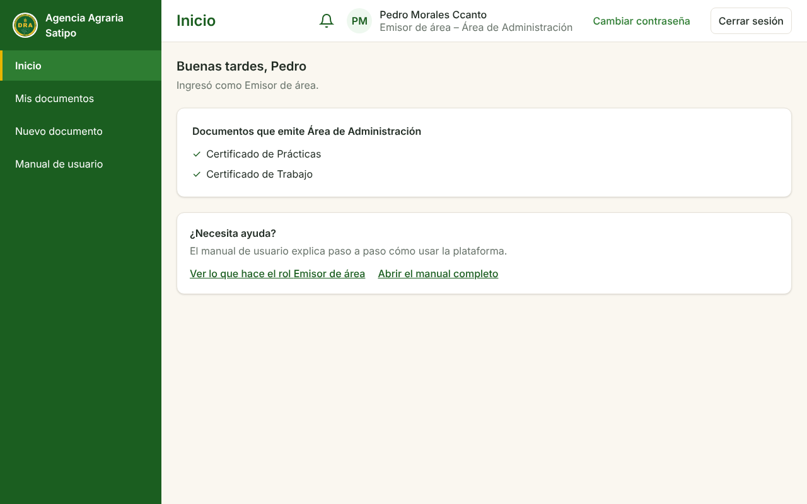
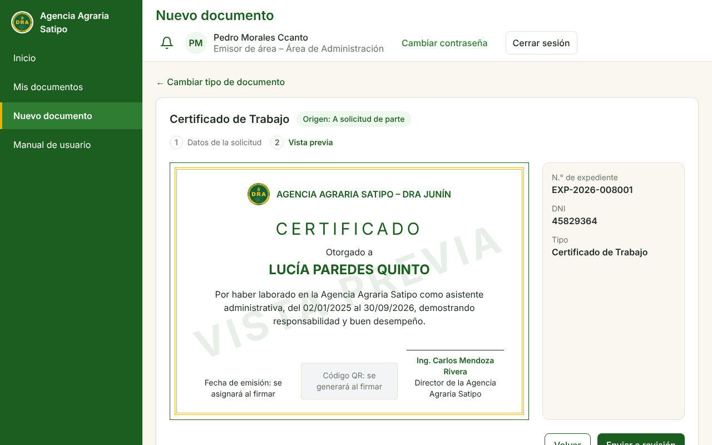
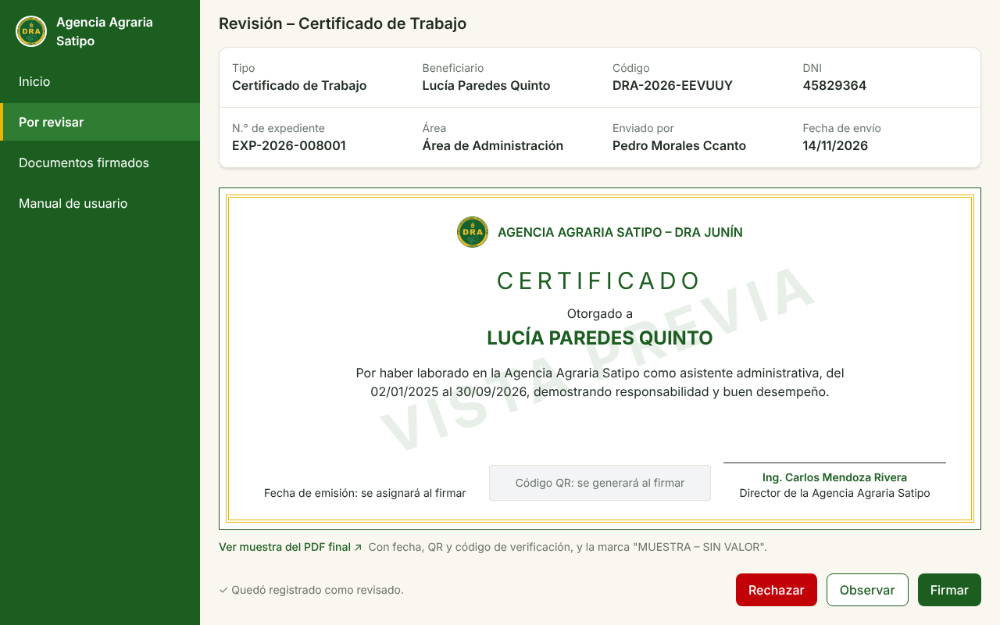
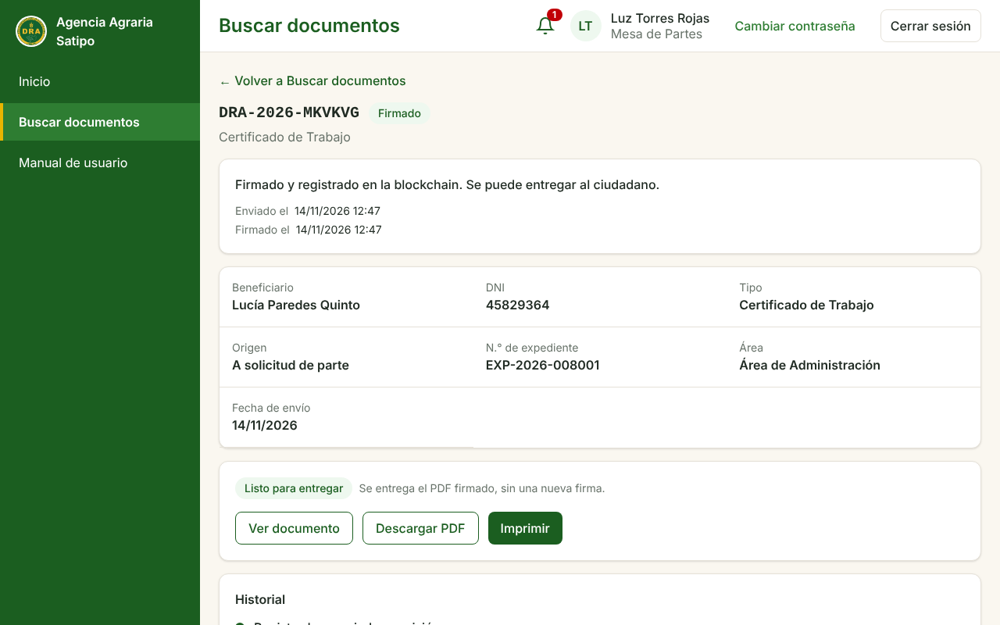

# Manual de usuario

Versión 1 · Plataforma de Certificados y Constancias de la Agencia Agraria Satipo

Este manual explica cómo usar la plataforma interna. Lea primero _La plataforma en una página_ y _Para todos_, y luego la sección de su rol. Los textos en **negrita** son los que verá en la pantalla.

## La plataforma en una página

La plataforma sirve para tres cosas: _emitir_ los certificados y constancias de la agencia, que el Director los _firme_ digitalmente y que cualquier persona pueda _verificar_ que son auténticos.

| Rol                    | Qué hace                                                                                          | Opciones del menú                                                            |
| ---------------------- | ------------------------------------------------------------------------------------------------- | ---------------------------------------------------------------------------- |
| Administrador          | Crea y mantiene las cuentas, las áreas y los tipos de documento, y habilita la firma del Director | **Inicio**, **Usuarios**, **Billetera del director**, **Áreas y documentos** |
| Emisor de área         | Registra los documentos de su área, corrige los observados y reemite los que tienen errores       | **Inicio**, **Mis documentos**, **Nuevo documento**                          |
| Director               | Revisa, observa, rechaza, firma y anula documentos                                                | **Inicio**, **Por revisar**, **Documentos firmados**                         |
| Mesa de Partes         | Busca cualquier documento, informa su estado, ve su historial e imprime o descarga los firmados   | **Inicio**, **Buscar documentos**                                            |
| Mesa de Partes de área | Lo mismo que Mesa de Partes, pero solo con los documentos de su área                              | **Inicio**, **Buscar documentos**                                            |

Todos tienen además la opción **Manual de usuario**, la campana de avisos y **Cambiar contraseña**.

### La vida de un documento

Un documento enviado _no se modifica_. Si hay que cambiar algo, se observa y se corrige (antes de firmar) o se reemite (después de firmar). Todo queda en su historial.

| Estado               | Qué significa                                                                      |
| -------------------- | ---------------------------------------------------------------------------------- |
| **Pendiente**        | Está en revisión del Director. Todavía no se puede entregar.                       |
| **Observado**        | El Director pidió corregirlo. El área lo corrige y lo vuelve a enviar.             |
| **Rechazado**        | El Director lo rechazó. Es definitivo: si corresponde, se inicia un nuevo trámite. |
| **Procesando firma** | El Director lo está firmando. Estará listo en unos minutos.                        |
| **Firmado**          | Firmado y registrado en la blockchain. Se puede entregar.                          |
| **Anulado**          | Fue anulado y ya no es válido.                                                     |

Algunos tipos de documento tienen vigencia: después de su fecha "Válido hasta", el documento firmado aparece como **Vencido** y ya no se entrega.

## Para todos

### Ingresar

1. Abra la dirección de la plataforma que le dio el Administrador.
2. Escriba su **Usuario** y su **Contraseña**, y pulse **Ingresar**.
3. La primera vez, o si el Administrador le restableció la contraseña, verá **Cambie su contraseña**: escriba la contraseña temporal y una nueva, de 8 a 20 caracteres, y pulse **Cambiar contraseña**.

Tenga en cuenta:

- Después de 3 intentos fallidos seguidos, la cuenta se bloquea una hora. El Administrador puede desbloquearla antes, restableciendo su contraseña.
- Después de 30 minutos sin actividad, la sesión se cierra sola. Vuelva a ingresar.
- Si intenta abrir una pantalla que no corresponde a su rol, verá "No tiene permiso para ver esta sección".
- Al terminar, pulse **Cerrar sesión**, sobre todo en una computadora compartida.

### Cambiar su contraseña

En el encabezado, pulse **Cambiar contraseña**. Escriba la actual y la nueva dos veces. Nadie más, ni siquiera el Administrador, puede ver su contraseña.

### Los avisos

La campana del encabezado muestra cuántos avisos tiene sin leer. Al pulsar un aviso, se abre el documento o el lote. Con **Marcar todos como leídos** los marca de una vez.

- El Director recibe un aviso cuando llega algo para revisar.
- El Emisor de área recibe un aviso cuando un documento de su área se firma, se observa, se rechaza o se anula.
- Mesa de Partes recibe un aviso cuando un documento está listo para entregar o fue rechazado.

Los avisos solo se ven en la plataforma: no llegan por correo ni por SMS.

## Para el Administrador

### Crear y mantener las cuentas

1. En **Usuarios**, pulse **Nueva cuenta**.
2. Complete el nombre de usuario, el nombre completo, el rol y una contraseña temporal. Si el rol trabaja con un área (Emisor de área o Mesa de Partes de área), elija su área.
3. Pulse **Crear cuenta** y entregue a la persona su usuario y su contraseña temporal. Al ingresar, tendrá que cambiarla.

En la lista de cuentas puede:

- **Editar** el nombre, el rol o el área y pulsar **Guardar cambios**. El nombre de usuario no cambia.
- **Restablecer contraseña**, si alguien la olvidó o se bloqueó: le asigna una nueva contraseña temporal.
- **Desactivar cuenta**, si la persona deja la agencia: pierde el acceso al instante y su historial se conserva. Con **Reactivar cuenta** vuelve a tenerlo.

Las cuentas nunca se borran. Usted no puede desactivarse a sí mismo, y siempre queda al menos un Administrador activo.

### Áreas y tipos de documento

En **Áreas y documentos**:

- Pulse **Nueva área** y luego **Crear área** para agregar un área. Puede cambiarle el nombre con **Guardar nombre**, o **Deshabilitar** un área que ya no emite documentos (y **Reactivar** después).
- En cada área, con **Asignar** le habilita un tipo de documento, y con **Quitar** se lo retira.
- En los tipos con vigencia, indique los meses de vigencia y pulse **Guardar**.

### La billetera del Director

El Director firma con una _billetera digital_ (MetaMask). Para habilitarla:

1. En **Billetera del director**, registre la dirección de la billetera del Director y pulse **Guardar billetera**.
2. Pulse **Otorgar rol de firmante**, luego **Conectar billetera y continuar** y **Confirmar en la billetera**. En su MetaMask debe estar _su_ billetera de administrador del contrato.
3. Cuando la fila del Director muestre "✓ Firmante activo", ya puede firmar.

Si cambia el Director, revoque el permiso de la billetera anterior y otórguelo a la nueva. Los documentos firmados antes siguen siendo válidos.

## Para el Emisor de área

Usted solo ve y registra los documentos de su área.

### Registrar un documento

1. En **Nuevo documento**, elija el tipo. Solo verá los tipos que emite su área.
2. Complete el formulario: el número de expediente de Mesa de Partes, los nombres, los apellidos, el DNI y los datos propios del tipo.
3. Pulse **Continuar a vista previa** y revise el documento tal como quedará.
4. Pulse **Enviar a revisión**. El documento queda **Pendiente**, con su código de verificación (por ejemplo, DRA-2026-F8R2MA), y ya no se puede modificar.

Siga su avance en **Mis documentos**.

### Emitir certificados por lista

Para los certificados de un mismo evento, como un taller:

1. En **Nuevo documento**, elija el tipo de certificado y escriba una sola vez los datos del evento.
2. Agregue a los beneficiarios: uno por uno con **Agregar beneficiario**, o con **Descargar plantilla Excel**, que llena y sube después.
3. La plataforma revisa cada fila y marca los errores (DNI inválido o repetido, nombre vacío). Corríjalos.
4. Revise el certificado de ejemplo y pulse **Enviar**. Se crea un documento por beneficiario, agrupados en un lote.

### Corregir un documento observado

1. En **Mis documentos**, el documento aparece **Observado**, con el motivo del Director.
2. Pulse **Corregir y reenviar**: el formulario viene con lo que envió.
3. Corrija y pulse **Reenviar a revisión**. El documento conserva su código y vuelve a **Pendiente** con la etiqueta "Corregido".

### Reemitir un documento firmado con un error

Si un documento ya firmado tiene un error (por ejemplo, un apellido mal escrito):

1. Ábralo en **Mis documentos** y pulse **Reemitir con corrección**.
2. Corrija los datos y escriba el **Motivo de la reemisión**.
3. Envíelo. Se crea un documento nuevo, con otro código. Cuando el Director lo firme, el original se anula solo.

## Para el Director

### Revisar

**Por revisar** muestra lo que enviaron las áreas, del más antiguo al más reciente. Cada lote es un solo elemento. Las etiquetas "Corregido" y "Reemisión" señalan los casos especiales.

Abra cada documento o lote para revisarlo: la plataforma no le deja firmar lo que no abrió. En una reemisión verá qué datos cambiaron y por qué.

### Decidir

| Decisión | Cuándo                     | Cómo                                                           |
| -------- | -------------------------- | -------------------------------------------------------------- |
| Firmar   | El documento está correcto | **Firmar** (o **Firmar lote**) y confirme en su billetera      |
| Observar | Hay algo que corregir      | **Observar**, escriba el **Motivo** y confirme. Vuelve al área |
| Rechazar | No debe emitirse           | **Rechazar**, escriba el **Motivo** y confirme. Es definitivo  |

En un lote puede observar o rechazar a algunos beneficiarios y firmar al resto. Para firmar varios a la vez, selecciónelos en **Por revisar** y pulse **Firmar seleccionados**.

### Firmar con la billetera

Necesita MetaMask en su navegador, con la billetera que registró el Administrador. Al firmar, la plataforma comprueba su billetera, le pide confirmar en MetaMask (no tiene costo) y registra la firma en la blockchain. Al terminar verá cuántos documentos se firmaron.

Si MetaMask muestra un error después de que se restauró una copia de respaldo de la plataforma, restablezca su cuenta en MetaMask (en su configuración avanzada, "Borrar datos de actividad"). No se borra su billetera.

### Anular un documento firmado

1. En **Documentos firmados**, pulse **Anular** junto al documento.
2. Escriba el motivo y confirme con **Anular con su billetera**. La anulación es definitiva.
3. Desde ese momento, el portal lo muestra anulado y Mesa de Partes ya no puede imprimirlo.

## Para Mesa de Partes

Mesa de Partes de área trabaja igual, pero solo ve los documentos de su área.

### Buscar un documento

1. En **Buscar documentos**, escriba un nombre, un DNI, un código, un número de expediente o un número de lote. No importan las tildes ni las mayúsculas.
2. Use los filtros (**Todos**, **Listos para entregar** y los demás) para acotar.
3. Abra la ficha del documento: verá su estado explicado, sus datos y, si fue observado, rechazado o anulado, el motivo.
4. En **Historial** está cada paso del trámite, con fecha, hora y responsable.

### Imprimir y entregar

En la ficha de un documento firmado, pulse **Ver documento**, **Descargar PDF** o **Imprimir**. Antes de entregarlo, la plataforma lo verifica con la blockchain: si no coincide o está anulado, no lo entrega.

Si el ciudadano perdió su documento, use **Imprimir duplicado**: es el mismo documento, con el mismo código y el mismo QR, sin volver a firmarlo.

## La verificación pública

Cualquier persona puede verificar un documento en el portal público, sin registrarse: escaneando su código QR o escribiendo su código de verificación. Verá si es válido, anulado, vencido o no válido. Si es válido y usó el QR, verá también el documento completo.

Si un ciudadano pregunta cómo hacerlo, indíquele la guía "¿Cómo verificar un documento?" del portal.

## Glosario

| Término                      | Qué significa                                                                                                                                                 |
| ---------------------------- | ------------------------------------------------------------------------------------------------------------------------------------------------------------- |
| Blockchain                   | Un registro digital donde lo anotado no se puede borrar ni cambiar sin que se note. La agencia tiene el suyo, privado. Ahí queda cada firma y cada anulación. |
| Billetera digital (MetaMask) | La aplicación con la que el Director firma. Es como su firma personal: solo él la tiene y la plataforma nunca la guarda.                                      |
| Código de verificación       | El código impreso debajo del QR, por ejemplo DRA-2026-F8R2MA. Identifica al documento.                                                                        |
| Expediente                   | El número del trámite en Mesa de Partes.                                                                                                                      |
| Lote                         | Los certificados de un mismo evento, emitidos de una vez.                                                                                                     |
| Reemisión                    | Un documento nuevo que corrige a uno ya firmado; al firmarse, el original se anula.                                                                           |
| Duplicado                    | Una nueva impresión del mismo documento, con el mismo código y QR.                                                                                            |
