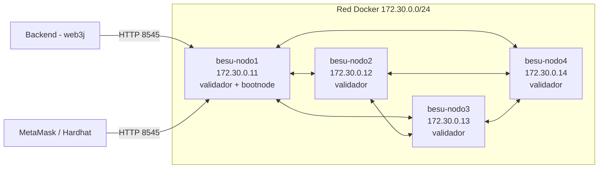

# Red Hyperledger Besu (QBFT, 4 validadores)

Red blockchain permisionada, compatible con EVM, para desarrollo local (RNF11). Tarea Jira: DRA-45.

## Características

| Parámetro | Valor | Requerimiento |
|---|---|---|
| Cliente | Hyperledger Besu 26.10.2 (imagen `hyperledger/besu`) | RNF11 |
| Consenso | QBFT, 4 validadores. Tolera la falla de 1 nodo, porque QBFT necesita más de 2/3 de validadores activos | RNF11 |
| Tiempo de bloque | 2 segundos | RNF01 |
| `chainId` | 20260 | — |
| Hito de la EVM | Cancun (`cancunTime: 0`). El contrato se compila con `evmVersion: cancun` | — |
| Costo de transacción | 0: `zeroBaseFee` en el génesis y `min-gas-price=0` en cada nodo. Una cuenta sin saldo puede operar | RNF11 |
| Permisos | Lista de nodos permitidos (`permissions_config.toml`): solo se conectan los 4 validadores | RNF11 |
| RPC | Solo el nodo 1 lo expone fuera de Docker: HTTP en `localhost:8545` y WebSocket en `localhost:8546` | — |



## Archivos

| Archivo | Se versiona | Contenido |
|---|---|---|
| `qbftConfigFile.json` | Sí | Plantilla del génesis y número de validadores |
| `generar-red.sh` | Sí | Genera claves, génesis, configuración de cada nodo y lista de permitidos |
| `red/` | **No** (`.gitignore`) | Salida del script: `genesis.json`, `permissions_config.toml` y `nodoN/{key, key.pub, config.toml, direccion}` |

Las claves privadas de los validadores **no se suben al repositorio**. Cada entorno genera las suyas. Las de producción (DRA-44) se custodian aparte.

## Uso

```bash
cd plataforma/infra

# 1. Generar la red (una sola vez)
./besu/generar-red.sh

# 2. Levantar PostgreSQL y los 4 nodos
docker compose --profile besu up -d

# 3. Comprobar
curl -s -X POST -H 'Content-Type: application/json' \
  --data '{"jsonrpc":"2.0","method":"qbft_getValidatorsByBlockNumber","params":["latest"],"id":1}' \
  http://localhost:8545

# 4. Prueba completa: despliegue de un contrato y lectura de su evento
cd ../contracts && BESU_RPC_URL=http://localhost:8545 npm run probar:besu
```

| Acción | Comando |
|---|---|
| Ver registros de un nodo | `docker compose --profile besu logs -f besu-nodo1` |
| Detener (conserva la cadena) | `docker compose --profile besu down` |
| Empezar de cero (nuevas claves y cadena vacía) | `./besu/generar-red.sh --forzar` |

## Conectar MetaMask (desarrollo)

Agregar una red personalizada con RPC `http://localhost:8545`, ID de cadena `20260` y símbolo `ETH`. Como el gas cuesta 0, cualquier cuenta puede firmar sin tener saldo.

## Verificación

- **Local (29/10/2026):** con los 4 nodos sincronizados en el mismo bloque y 3 pares por nodo, una cuenta nueva con saldo 0 desplegó un contrato con `gasPrice 0`, envió una transacción y se leyó su evento. El saldo terminó en 0.
- **CI:** el job **Red Besu** de `.github/workflows/ci.yml` repite la prueba en cada push con el contrato `PruebaRed.sol` (`npm run probar:besu`). Ver [integración continua](../../../docs/arquitectura/integracion-continua.md).
