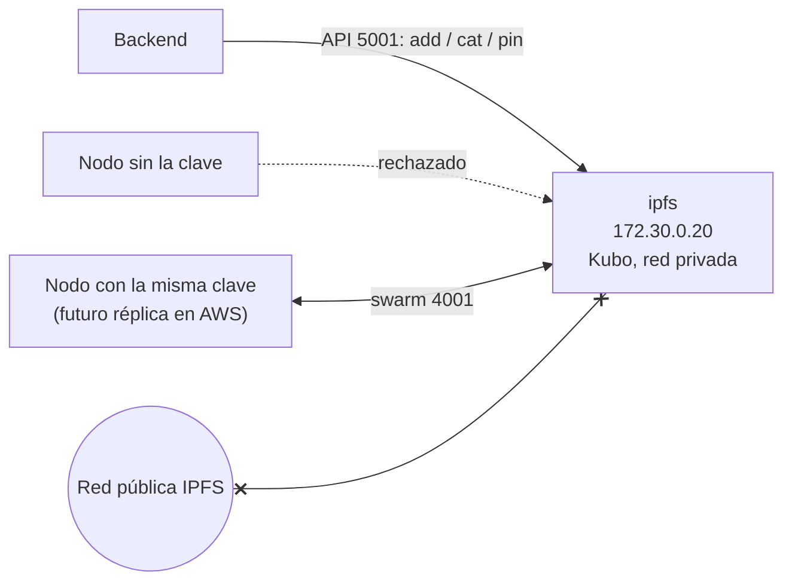

# Nodo IPFS privado

Almacenamiento de los PDF firmados de la plataforma (RNF03, HU17). Tarea Jira: DRA-46.

## Características

| Parámetro | Valor | Motivo |
|---|---|---|
| Software | Kubo v0.43.1 (imagen `ipfs/kubo`) | Implementación de referencia de IPFS |
| Red | **Privada**: clave de enjambre (`swarm.key`) y `LIBP2P_FORCE_PNET=1` | RNF03: los PDF tienen datos personales y no deben circular por la red pública de IPFS |
| Nodos de arranque | Ninguno (`bootstrap rm --all`, `AutoConf.Enabled=false`) | No se conecta a la red pública |
| Descubrimiento y anuncio | Desactivados: mDNS, DHT (`Routing.Type=none`), anuncio de contenido, relay, AutoNAT y AutoTLS | No se publica el contenido ni la presencia del nodo |
| API | `http://localhost:5001`, publicada solo en `127.0.0.1` | La usa el backend; no queda expuesta a la red local |
| Gateway HTTP | `http://localhost:8081`, publicado solo en `127.0.0.1` | Lectura de archivos por CID en desarrollo. El 8080 lo usa el backend |
| Identificadores | CIDv1 (`bafy…` para archivos grandes como los PDF, `bafk…` para archivos pequeños) | Mismo formato que muestra el prototipo |



## Archivos

| Archivo | Se versiona | Contenido |
|---|---|---|
| `generar-clave.sh` | Sí | Genera la clave de enjambre en `red/swarm.key` |
| `init/001-red-privada.sh` | Sí | Configuración que aísla el nodo; Kubo la ejecuta en cada arranque (`/container-init.d`) |
| `probar-ipfs.sh` | Sí | Prueba de humo: red privada y subida/recuperación por CID |
| `probar-aislamiento.sh` | Sí | Prueba de aislamiento con nodos temporales con y sin la clave |
| `red/swarm.key` | **No** (`.gitignore`) | Clave de enjambre. Quien la tenga puede unirse a la red: se trata como un secreto |

## Uso

```bash
cd plataforma/infra

# 1. Generar la clave de enjambre (una sola vez)
./ipfs/generar-clave.sh

# 2. Levantar el nodo
docker compose --profile ipfs up -d ipfs

# 3. Pruebas
./ipfs/probar-ipfs.sh
./ipfs/probar-aislamiento.sh
```

Con `COMPOSE_PROFILES=besu,ipfs` en `.env` (ver `.env.example`), `docker compose up -d` levanta PostgreSQL, Besu e IPFS juntos.

| Acción | Comando |
|---|---|
| Subir un archivo | `curl -X POST -F file=@documento.pdf "http://localhost:5001/api/v0/add?cid-version=1&pin=true"` |
| Recuperarlo | `curl -X POST "http://localhost:5001/api/v0/cat?arg=<CID>" -o documento.pdf` o `http://localhost:8081/ipfs/<CID>` |
| Interfaz web | `http://localhost:5001/webui` |
| Nueva clave (borra el contenido) | `docker compose --profile ipfs down -v && ./ipfs/generar-clave.sh --forzar` |

## Decisiones

- **Un solo nodo en desarrollo.** La red privada admite más nodos con la misma clave. La réplica para alta disponibilidad (RNF06) se define en la infraestructura de AWS (DRA-44).
- **Sin el perfil `server` de Kubo.** Ese perfil bloquea las conexiones desde IPs privadas, que es justo lo que usa una red privada entre contenedores o dentro de una VPC.
- **Archivos fijados (`pin=true`).** Así el recolector de basura de IPFS no los borra (HU17, HU25).
- **El backend lo usa desde HU17.** Al preparar la firma, guarda cada PDF final con `add?cid-version=1&raw-leaves=false&pin=true` y conserva su CID en PostgreSQL. La dirección se configura con `PLATAFORMA_IPFS_URL`. La prueba de punta a punta usa un nodo propio y vacío en el puerto 5002, con esta misma clave y configuración.
- **IPFS no reemplaza a la blockchain.** IPFS guarda el PDF; la blockchain guarda su hash SHA-256 (HU16). La verificación (HU21) recalcula el hash del PDF recuperado de IPFS y lo compara con el registrado.

## Verificación (29/10/2026)

- **Local:**
  - 0 nodos de arranque y 0 pares.
  - Archivo subido con CIDv1, recuperado byte a byte idéntico y fijado.
  - Un nodo sin la clave fue rechazado ("failed to negotiate security protocol") y uno con la misma clave se conectó.
  - El nodo arranca sin errores de configuración.
- **CI:** el job **IPFS privado** repite las dos pruebas en cada push. Ver [integración continua](../../../docs/arquitectura/integracion-continua.md).
